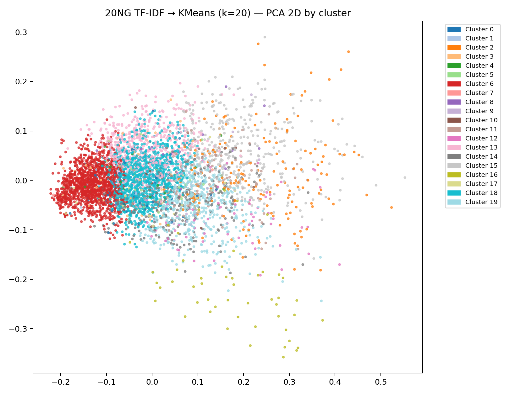
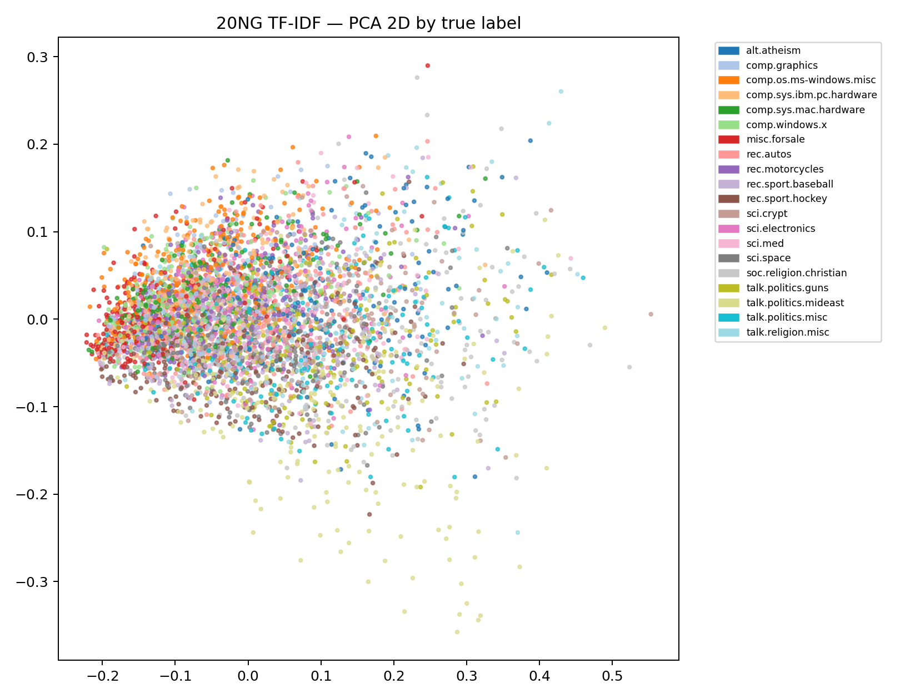

# Large-Scale NLP & Document Clustering

An MSc coursework investigation of text representations, news classification, and unsupervised document clustering. The historical scored runs use **scikit-learn and gensim**; separate PySpark source variants are included, with no measured multi-node speedup claimed.

[Read the portfolio case study](https://godwineakpan.com/projects/nlp-document-clustering)

## Questions and findings

1. **Semantic exploration:** Word2Vec on Text8 produced interpretable nearest-neighbour relationships. This is qualitative evidence, not a benchmark score.
2. **Headline classification:** Logistic Regression with TF-IDF outperformed averaged Word2Vec in the saved runs.
3. **Document clustering:** K-means selected k=20 from the tested candidates, but all sampled silhouette scores were negative. The outcome is weak separation, not successful topic discovery.

| Headline representation | Macro-F1 (saved CSV) |
| --- | ---: |
| TF-IDF + Logistic Regression | 0.415432 |
| Averaged Word2Vec + Logistic Regression | 0.235313 |
| Fast averaged Word2Vec + Logistic Regression | 0.168697 |

Saved notebook output reports **209,527 headlines, 42 labels**, and an **167,621 / 41,906** stratified train/test split. These are historical outputs, not a rerun for this repository update. Different embedding settings mean this should not be called a representation-only controlled experiment or statistically significant improvement.


## Clustering result

The saved local notebook reports **18,846 documents and 20 labels**. Sampled silhouette: k=10: -0.0119; k=15: -0.0099; k=20: -0.0079. Sampling is capped at 5,000 documents. A 2D PCA view is an inspection aid and does not substitute for a cluster-quality metric.




## Files and run guidance

- `notebooks_or_src/task1b_news_category_classification.py`: code cells exported from the completed classification notebook.
- `notebooks_or_src/task1c_20ng_clustering.py`: recovered local Python clustering implementation.
- `notebooks_or_src/3_clustering_20ng.py`: separate Spark clustering implementation; do not attribute local-run scores to it.
- `results/`: original classification-report CSVs, macro-F1 summary, and a saved-run summary.
- `figures/`: original PNG outputs.

Source snapshots are preserved for inspection and have not been rerun or turned into a fully pinned release. The scripts expect a sibling `Data/` directory. From `notebooks_or_src`, after preparing the data and a compatible environment:

```sh
python task1b_news_category_classification.py
python task1c_20ng_clustering.py
```

Required data: Text8; the Kaggle News Category Dataset v3; and a `Data/20newsgroups/20ng.csv` file with `text,label` columns. Follow each dataset's terms and cite its original author. Do not upload the raw corpora merely to make the repository larger.

Environment components used by the local scripts include Python, numpy, pandas, scikit-learn, gensim, and matplotlib. The Spark variant additionally requires Java and PySpark. Exact environment versions remain to be recovered; the report and README previously disagreed about the Spark version.

## Limitations and next steps

- Publish a run manifest connecting each score to its split seed, representation settings, corpus version, and environment.
- Reconcile the TF-IDF feature-cap description with the code and distinguish Text8 exploration from headline-trained embedding variants.
- Evaluate repeated seeds, contextual embeddings or truncated SVD, and external cluster metrics such as ARI/NMI.
- Related frequency-estimation experiments exist, but their curves conflict with the report's convergence narrative. Do not promote them as validated results until reconciled.

Academic provenance: Machine Learning on Big Data coursework, October 3, 2025. No production text-classification or document-search deployment is claimed.
