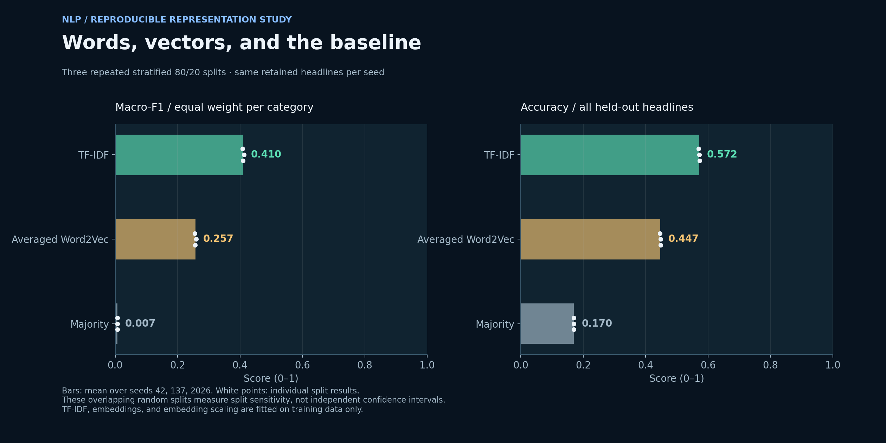
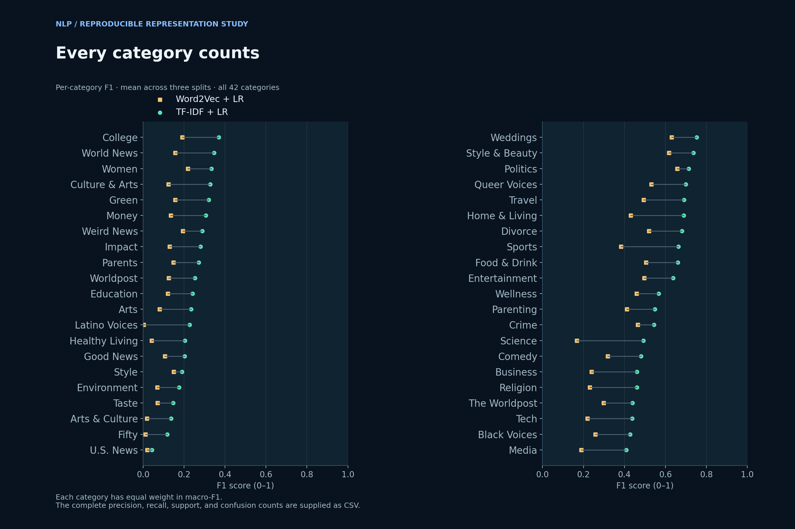
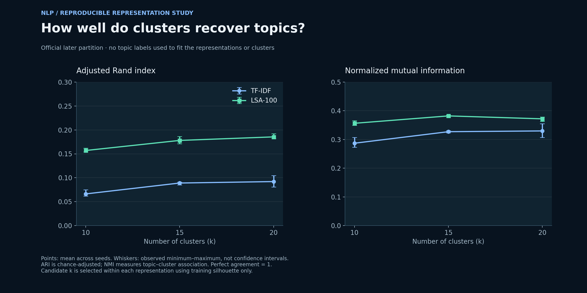
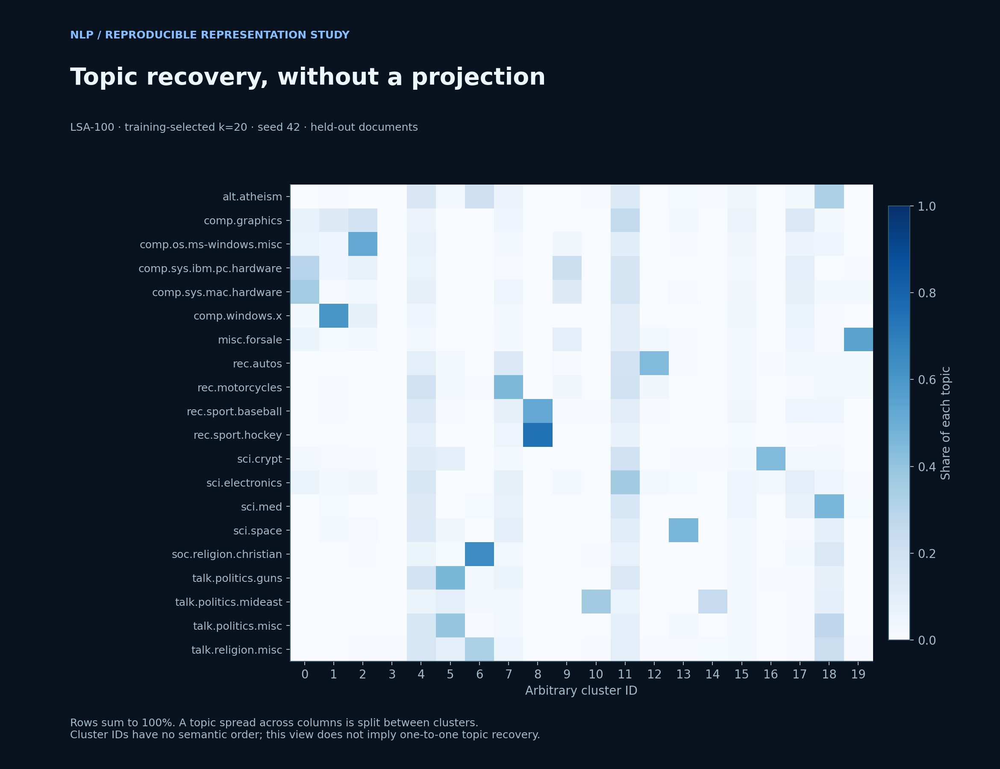

# NLP & Document Clustering

A reproducible study of how text representations support classification and unsupervised topic recovery. The project pairs a strong lexical baseline with averaged Word2Vec, evaluates every headline category, and tests document clusters on an unseen partition.

[Explore the portfolio case study](https://godwineakpan.com/projects/nlp-document-clustering)



## Engineering contribution

Implemented leakage-aware text preparation, training-only feature learning, repeated classifier evaluation, sparse TF-IDF and normalized latent semantic analysis (LSA), held-out clustering evaluation, result reconciliation, and publication figures.

## Headline classification

The News Category Dataset v3 supplies 209,527 records. Cleaning retains **206,959 headlines across 42 categories**. Empty normalized text, conflicting-label text groups, and duplicate normalized headlines are removed before splitting. Full removal counts are in `results/summary.json`.

Each of seeds 42, 137, and 2026 defines the same stratified 80/20 partition for all three classifiers. Text normalization lowercases and retains alphabetic tokens; only the headline predicts category. Feature fitting uses training text only.

| Model | Mean macro-F1 | Mean accuracy |
| --- | ---: | ---: |
| Majority | 0.0069 | 0.1700 |
| TF-IDF + LR | 0.4099 | 0.5719 |
| Word2Vec + LR | 0.2569 | 0.4475 |

Macro-F1 gives each category equal weight. Individual split scores are retained; these overlapping splits are not independent samples or confidence intervals.

- **TF-IDF:** up to 100,000 unigram/bigram features, L2 normalization, default smoothed IDF.
- **Word2Vec:** 200-dimensional CBOW; window 5, minimum count 5, 5 epochs, one worker, declared seed. Average in-vocabulary vectors; unknown-only headlines receive a zero vector. Standardize using training means/scales.
- **Logistic Regression:** C=1, L-BFGS, maximum 1,000 iterations, tolerance 1e-4. Convergence warnings fail the run. No hold-out hyperparameter tuning.
- **Baseline:** always predict the training majority category.



## Held-out document clustering

Use the official 20 Newsgroups by-date archive: 11,314 earlier and 7,532 later documents before cleaning. Remove headers, footers, and quotations with scikit-learn's pinned cleaning functions; normalize text; remove empty/duplicate normalized documents and test overlap with training. Exclude documents with no retained TF-IDF features. The evaluated partitions contain **10,946 training and 7,253 held-out documents**.

- Training-only TF-IDF: maximum 50,000 unigram features, min_df=2, max_df=0.5, English stop list, sublinear term frequency, L2 normalization.
- Compare sparse TF-IDF with training-fitted truncated SVD (100 components, 7 power iterations, seed 42) followed by L2 normalization. SVD retains 10.4% of training explained variance.
- K-means: k in {10,15,20}, n_init=10, max_iter=300, three seeds. Predict held-out cluster assignments from training centroids.
- Select k **within each representation** by mean training silhouette on a fixed sample of 1,500 documents (sampling seed 99). Cosine distance for TF-IDF, Euclidean for normalized LSA; absolute silhouette scores across these geometries are not directly comparable.
- Held-out topic labels are used only for ARI/NMI evaluation. All candidate results are exported, rather than choosing k using test labels.

| Representation | Training-selected k | Mean held-out ARI | Mean held-out NMI |
| --- | ---: | ---: | ---: |
| TF-IDF | 20 | 0.0920 | 0.3298 |
| LSA-100 | 20 | 0.1854 | 0.3719 |





The association matrix shows each topic's distribution across cluster IDs for seed 42 and training-selected LSA k. It is a direct contingency view, without a potentially misleading two-dimensional projection.

## Further investigation: rare-word probability estimation

A separate, corrected Text8 study compares MLE, Simple Good–Turing, and absolute discounting across sample sizes and vocabulary definitions. Its **120 verified estimator runs** complement the representation experiments here.

[Read the experiment, code, results, and limitations](../3_LanguageModel_Discounting/README.md)

## Reproduce

Use Python 3.11 and install `requirements.txt` in a virtual environment. Obtain `News_Category_Dataset_v3.json` from the original dataset publisher and `20news-bydate.tar.gz` from the original archive; see [references](REFERENCES.md). Check the exact source SHA-256 values in `results/manifest.json`.

```powershell
./run.ps1 -News /path/to/News_Category_Dataset_v3.json -Groups /path/to/20news-bydate.tar.gz -Python python
```

This runs eight preparation/resume tests, all 27 model configurations, and the figures. Private prediction files are saved under ignored `private-results/`. Published outputs contain aggregate metrics and figures, not raw articles, message bodies, or individual predictions. The current implementation is `src/run_experiments.py`; older source snapshots and figures may remain in repository history and are superseded by these results.

## Limitations and next steps

- Random headline splits do not establish future-period or cross-publisher transfer. Categories can overlap semantically and reflect historical publisher conventions. Evaluate a temporal holdout next.
- Averaged CBOW is a bounded baseline; these results do not rank all embedding methods or contextual encoders. Common data and C do not mean equally optimized model families.
- Topic recovery is partial. Cleaning is heuristic; exact deduplication does not remove paraphrases or all thread relationships. Topic labels are reference categories, not a perfect taxonomy of each document's content.
- Sampled silhouette and seed ranges are descriptive. Different feature geometries prevent a direct silhouette comparison between representations.
- Single-machine scikit-learn/gensim execution establishes no distributed speedup or serving-capacity guarantee. Fixed seeds and one Word2Vec worker improve repeatability; pinned numerical environments still matter.

Full runs, per-category reports, confusion counts, topic/cluster tables, data-quality counts, code/input hashes, and verification status are in [results](results/).
