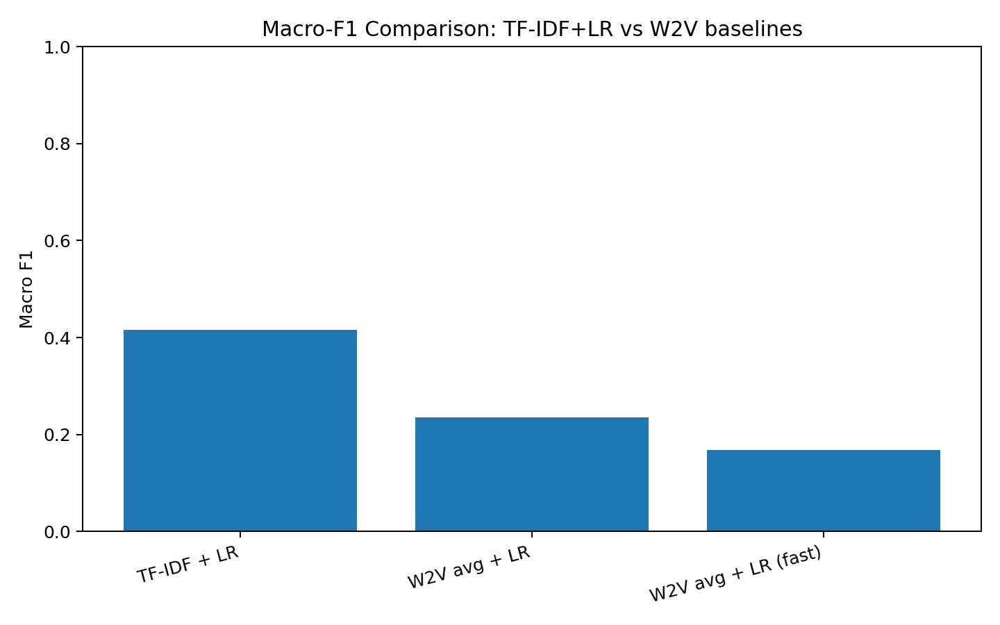

# Large-Scale NLP

An experimental workflow across Text8 embeddings, news-headline classification, and 20 Newsgroups clustering. The central result: a lexical baseline outperformed averaged embeddings, while clustering exposed substantial topic overlap.

[Read the portfolio case study](https://godwineakpan.com/projects/nlp-document-clustering)

## Engineering contribution

Implemented text preprocessing, feature comparisons, classification evaluation, and K-means/PCA exploration across three text corpora.

## Workflow

1. **Prepare the corpora:** Load Text8, news headlines, and 20 Newsgroups. Lowercase and tokenize text with an alphabetic regex.
2. **Compare representations:** Explore Word2Vec neighbours and use TF-IDF or averaged embedding vectors as inputs to Logistic Regression.
3. **Evaluate classification:** Use a stratified 80/20 headline split. Export class reports, macro-F1 comparisons, and a collapsed confusion matrix.
4. **Inspect clustering:** Test K-means with k ∈ {10, 15, 20}; select using sampled silhouette and compare PCA views coloured by cluster and true topic.

## Selected results

- **Headline classification — 0.4154 macro-F1.** TF-IDF plus Logistic Regression led this comparison; averaged Word2Vec achieved 0.2353 and the fast variant 0.1687.
- **Clustering insight — Topic overlap.** Across k=10, 15, and 20, sampled silhouette remained slightly negative. The useful result was identifying weak separation and motivating a better representation.
- **Implementation breadth — Python + Spark.** Local scikit-learn/gensim experiments provide the reported scores; separate Spark implementations explore scalable pipeline construction.

Macro-F1 across three headline-classification configurations. TF-IDF plus Logistic Regression outperformed the two averaged-embedding variants in these experiments.

## Engineering decisions

- **Start with a strong lexical baseline.** TF-IDF preserves discriminative words and phrases. Comparing it with averaged Word2Vec tests whether semantic features improve the task rather than assuming they will.
- **Match the metric to the question.** Macro-F1 gives each headline category weight, while silhouette and topic-coloured projections examine different aspects of unsupervised structure.
- **Inspect clusters from two perspectives.** PCA views coloured by cluster and by known topic make overlap visible and connect numerical evaluation to qualitative inspection.

## Scope and limitations

- **Comparison design.** Embedding variants use different training settings, and results come from a single split. Repeated seeds and consistent preprocessing are needed for a controlled comparison.
- **Cluster interpretation.** Silhouette was estimated on a sample and PCA is a two-dimensional projection. The observed overlap does not establish successful topic recovery; ARI/NMI and robustness checks would strengthen evaluation.
- **Scale evidence.** Reported scores belong to local Python runs. Separate Spark source does not establish distributed speedup or production serving performance.

## Code and reproducibility

Explore the [source snapshots](notebooks_or_src/) and original project figures. These are historical research results; the models and streaming jobs were not rerun for the portfolio presentation.

Selected outputs are in [results](results/). Source availability does not imply a pinned, one-command reproduction; environment versions, input acquisition, and a run manifest should be completed before rerunning.

## Next iteration

1. **Compare stronger representations.** Evaluate truncated SVD and contextual embeddings against TF-IDF under consistent preprocessing.
2. **Repeat the classification study.** Record corpus versions and model settings, repeat splits, and quantify variability in macro-F1.
3. **Evaluate clustering more fully.** Add ARI/NMI, inspect topic subsets, and measure robustness across seeds and representations.
