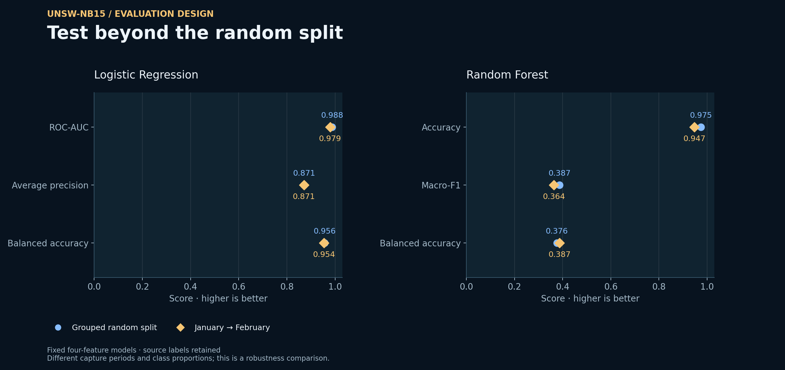
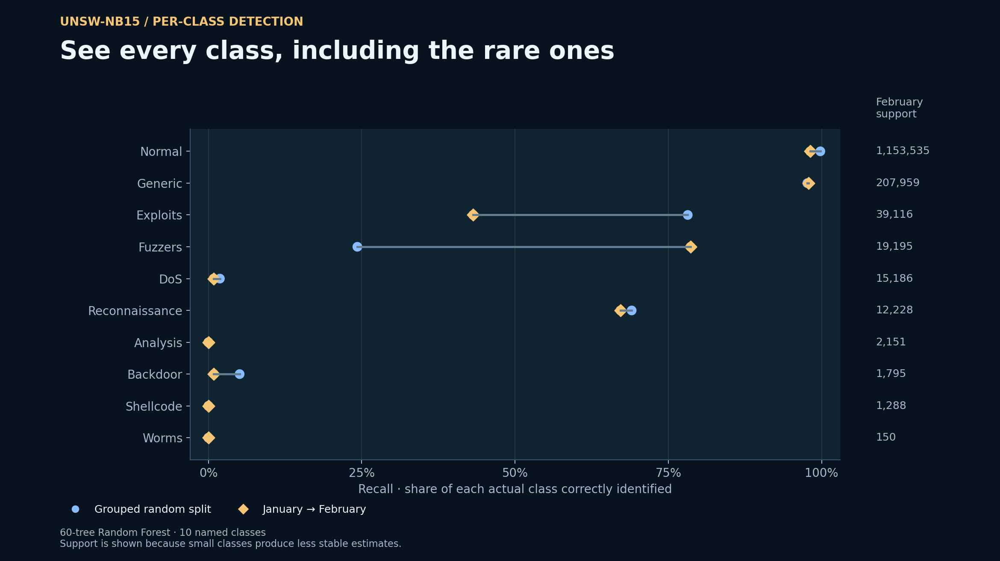
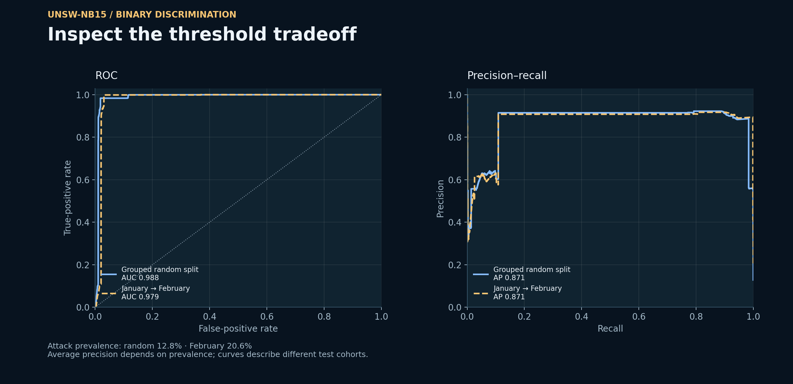
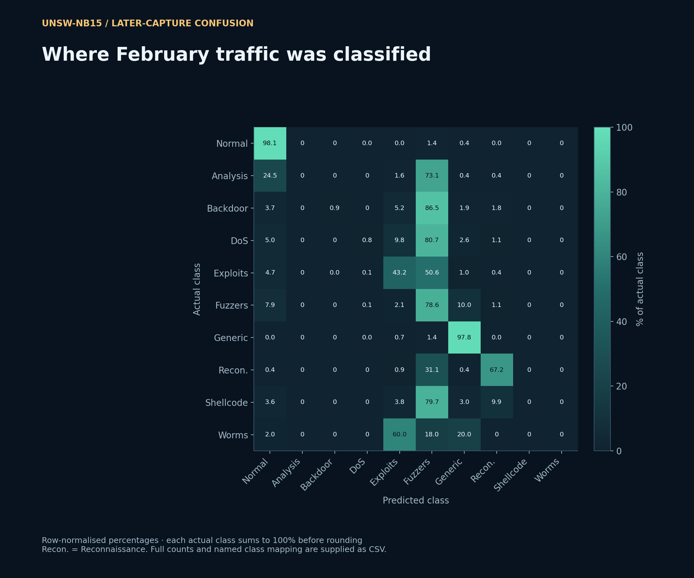

# Distributed Security Analytics — UNSW-NB15

A network-traffic analytics project connecting HDFS/Hive exploration with reproducible PySpark classification. The corrected workflow validates **2,539,739 flow records**, compares two evaluation designs, and makes minority-class detection visible alongside aggregate accuracy.

[Read the portfolio case study](https://godwineakpan.com/projects/distributed-security-analytics)



## Contribution

- Validated the headerless 49-column schema, numeric ranges, timestamps, and original binary-label semantics.
- Reconciled Backdoor/Backdoors and preserved a fixed, named ten-class mapping.
- Prevented identical records crossing the grouped-random split; used January training and February testing as the main later-capture evaluation.
- Reran Logistic Regression and Random Forest in PySpark, with a training-majority baseline and full per-class exports.
- Built reproducible figures, source/input hashes, and pinned execution requirements.

## Executed results

Run: 2026-10-18. Binary Logistic Regression and ten-class Random Forest solve different tasks; their accuracy and macro-F1 should not be compared as if they predict the same target.

| Evaluation | Model | Accuracy | Macro-F1 | Balanced accuracy |
|---|---|---:|---:|---:|
| group_random_70_30 | Majority baseline | 0.8717 | 0.0931 | 0.1000 |
| group_random_70_30 | Logistic Regression | 0.9776 | 0.9505 | 0.9563 |
| group_random_70_30 | Random Forest | 0.9746 | 0.3875 | 0.3759 |
| capture_holdout | Majority baseline | 0.7941 | 0.0885 | 0.1000 |
| capture_holdout | Logistic Regression | 0.9665 | 0.9494 | 0.9545 |
| capture_holdout | Random Forest | 0.9472 | 0.3640 | 0.3867 |

Later-capture Logistic Regression: **ROC-AUC 0.9794**, **average precision 0.8709**, attack prevalence 20.59%, fixed threshold 0.5. Average precision is the stepwise area measure, not a trapezoidal PR-area calculation.

Random Forest's grouped-random accuracy is 97.46%, but macro-F1 is 0.3875. In the later-capture test, accuracy is 94.72% and macro-F1 is 0.3640. The per-class view explains why a high overall score does not establish reliable rare-attack detection.







## Data and split contracts

The local extract contains 2,539,739 rows. The [official dataset description](https://research.unsw.edu.au/projects/unsw-nb15-dataset) reports 2,540,044 rows in the complete four-file corpus: this extract is 305 rows smaller, and their identities have not been established. No missing rows were invented. This project does not use or claim results on the separate official train/test benchmark partition.

The original binary label is authoritative: 0=Normal, 1=Attack. A missing category maps to Normal only if label=0. Known named attacks require label=1; disagreements and unknown labels stop execution. This extract has no binary/category disagreements under that contract. Blank categories are not a general-purpose proxy for normal traffic.

- **Grouped random 70/30:** Spark xxhash64 of a SHA-256 full-record fingerprint plus seed 42; exact duplicate records stay together. The resulting row ratio is approximate, not a stratified split. Extra exact duplicates in the input: 480,624.
- **Capture holdout:** fixed UTC boundary 1 February 2015. Training flows must end before the boundary; test flows must start at or after it. Observed captures are 22–23 January and 18 February. Class supports are exported for both partitions.
- Every required class must occur in training. Test data do not determine preprocessing, class order, parameters, or thresholds. Both fixed models are reported; none is selected by optimising a test score.
- Macro-F1 averages all ten declared classes for the multiclass task. Weighted F1 and accuracy reflect row frequency; balanced accuracy averages recall across supported classes.

## Models and features

Inputs: `log1p(sbytes)`, `log1p(dbytes)`, `sttl`, `dttl`. No source/destination address, port, capture timestamp, binary label, or category enters the feature vector. Dates only define the temporal partition.

- Logistic Regression: binary, L2 regParam=0.01, maxIter=100, tol=1e-7, training-only internal standardisation, decision threshold=0.5.
- Random Forest: ten classes, 60 trees, maxDepth=12, maxBins=64, minInstancesPerNode=5, seed=42, automatic feature subsampling.
- Majority baseline: always predict the most frequent training class.

## Reproduce

Use Python 3.11 and Java 11 with `JAVA_HOME` configured, then `pip install -r requirements.txt`. Supply an authorised original-format UNSW-NB15 flow CSV. Dataset files and raw predictions are not distributed.

```powershell
./run.ps1 -InputCsv /path/to/UNSW-NB15.csv -Python python
```

Portable direct commands:

```bash
python src/unsw_model_workflow.py --input /path/to/UNSW-NB15.csv --output . --private-output private-predictions --master 'local[4]'
python src/export_full_curves.py --project . --private-predictions private-predictions
python src/plot_results.py --project .
python -m unittest discover -s tests -v
```

On Windows, set `PYSPARK_PYTHON` and `PYSPARK_DRIVER_PYTHON` to the selected Python executable and `SPARK_HOME` to its installed pyspark directory; `run.ps1` handles these for that process. The tests require a working local Spark Python–Java connection. The original 49-column flow CSV and the separate official training/test subset have different schemas; the latter is deliberately rejected by this loader.

## Scope and limitations

The four-feature baseline omits richer flow context; inspect class recall before interpreting aggregate accuracy. This laboratory-generated 2015 corpus is not an external-network or contemporary-threat validation. Correlated flows can remain across partitions even when exact record overlap is zero. The temporal cohorts differ in class mix and training size, so their differences do not isolate a single causal mechanism.

Threshold 0.5 was not tuned for operational alert costs. Calibration, cost-sensitive validation, broader features, repeated capture periods, and external data remain next steps. The new models were run in **local PySpark on one machine**; this does not demonstrate multi-node scaling. HDFS/Hive ingestion belongs to the original engineering work and was not rerun here. Runtime exports describe this run only and are not a distributed speed benchmark.

## Inspect the evidence

- `results/model_metrics.csv`: full-precision aggregate scores.
- `results/per_class_metrics.csv`, `split_support.csv`: named class precision, recall, F1, and counts.
- `results/*_confusion.csv`: complete named confusion counts, including unpredicted classes.
- `results/*_roc.csv`, `*_pr.csv`: complete aggregate threshold curves, exported from all held-out predictions. The runner initially writes bounded previews; `export_full_curves.py` replaces these for the published figures.
- `results/manifest.json`: versioned parameters, source/input hashes, and split contract.
- `results/validation.json`: independent metric and split checks.

These results supersede the earlier archived scores. Feature transformations, model parameters, and partitions differ; differences from the historical 0.987 AUC and 96.7% accuracy should not be attributed solely to a bug fix. Existing historical figures may remain in repository history; the README links only the corrected rerun figures.

Dataset acquisition and required creator citations: [REFERENCES.md](REFERENCES.md).
