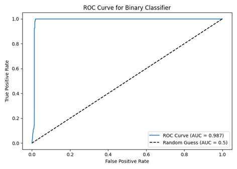

# Distributed Security Analytics

A Hadoop, Hive, and PySpark workflow connecting network-traffic ingestion, label normalization, SQL exploration, statistical analysis, and baseline intrusion classification across 2.54 million records.

[Read the portfolio case study](https://godwineakpan.com/projects/distributed-security-analytics)

## Engineering contribution

Designed the HDFS-to-Hive ingestion workflow, normalized traffic labels, profiled the dataset, and implemented interpretable classification baselines in PySpark.

## Workflow

1. **Store & query:** Load the CSV data into HDFS and expose it through an external Hive table. Confirm record and label counts.
2. **Normalize & profile:** Trim and lowercase category labels, reconcile missing categories against the binary label, and aggregate protocols and traffic volumes.
3. **Build baselines:** Assemble byte- and TTL-based features; fit binary Logistic Regression and a multiclass Random Forest with a 70/30 split and seed 42.
4. **Inspect evidence:** Review ROC output, predicted probabilities, class confusion, distributions, and statistical comparisons.

## Selected results

- **Binary Logistic Regression — 0.987 ROC-AUC.** Strong discrimination in the original random-split experiment using four byte/TTL features.
- **Multiclass Random Forest — 96.7% accuracy.** A 20-tree baseline on a 70/30 split with seed 42. Per-class evaluation remains the next step.
- **Dataset composition — 87.4% normal.** Normal traffic dominates the 2.54-million-record dataset, making class balance central to interpreting overall accuracy.

Logistic Regression ROC curve from the original binary classification experiment. The diagonal marks random discrimination; the curve shows the trade-off between true- and false-positive rates.

## Engineering decisions

- **Inspect labels before training.** Normalized category names and investigated the relationship between missing attack categories and normal traffic. This made label semantics an explicit part of the modelling workflow.
- **Connect SQL exploration to ML.** Used category and protocol aggregates to understand the dataset before selecting byte- and TTL-based features for interpretable baselines.
- **Evaluate at two levels.** Separated binary attack discrimination from multiclass classification, pairing ROC analysis with confusion-based inspection.

## Scope and limitations

- **Evaluation coverage.** Results come from one 70/30 random split. Temporal holdouts, repeated seeds, external-network testing, and per-class recall/macro-F1 are needed to assess generalization and rare-attack detection.
- **Label and schema validation.** The binary rule treats Unknown as normal and other category strings as attacks; any explicit Normal strings must be reconciled with the source binary label. Feature alignment and the fitted multiclass label order also need verification.
- **Execution scope.** Hadoop and Spark were used in a VM. Multi-node scaling, production intrusion detection, and SIEM integration were outside the evaluated scope.

## Code and reproducibility

Explore the [source snapshots](src/) and original project figures. These are historical research results; the models and streaming jobs were not rerun for the portfolio presentation.

Selected outputs are in [results](results/). Source availability does not imply a pinned, one-command reproduction; environment versions, input acquisition, and a run manifest should be completed before rerunning.

## Next iteration

1. **Strengthen detection evaluation.** Verify label mappings and schema, then measure PR-AUC, macro-F1, and per-class recall on temporal holdouts.
2. **Make runs repeatable.** Version the environment, preprocessing, class-index mapping, and full-precision metric exports.
3. **Measure distributed execution.** Benchmark partitions, elapsed time, memory, and executor topology on a defined workload.
