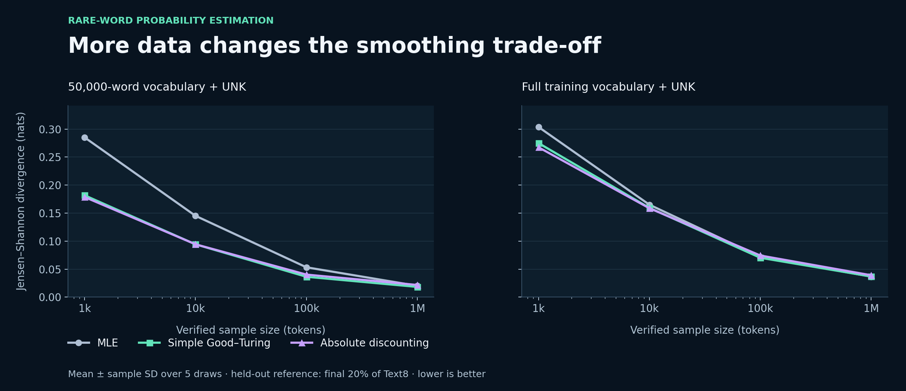
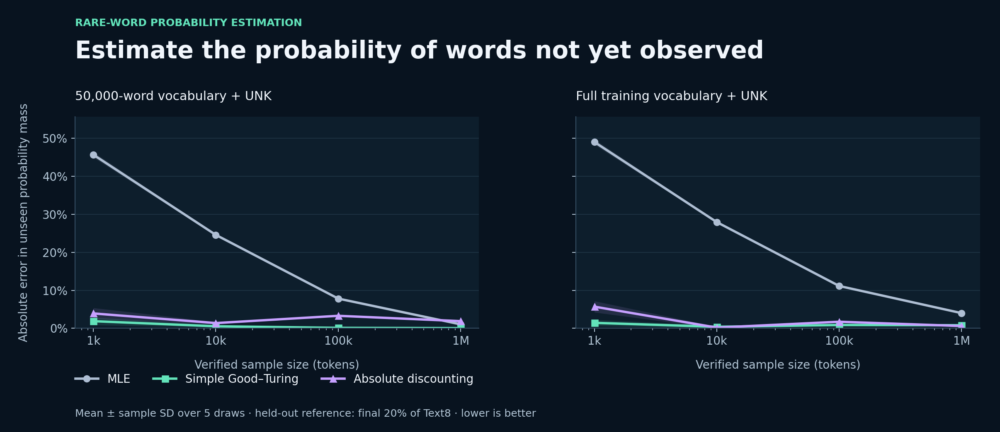

# Rare-Word Probability Estimation

A reproducible unigram study of how sample size and vocabulary design affect probability estimates for frequent and unseen words. It compares MLE, Simple Good–Turing, and absolute discounting on canonical Text8, with a separate held-out reference and repeated sampling.

[Explore the NLP case study](https://godwineakpan.com/projects/nlp-document-clustering#rare-word-estimation)

## Engineering contribution

Implemented normalized probability estimators, checksum-verified corpus preparation, exact-size sampling, repeated experiments, explicit zero-probability metrics, and publication figures. The workflow turns a smoothing comparison into an inspectable statistical experiment.



## Experiment design

- **Corpus:** canonical Text8, 17,005,188 lowercase tokens; source checksum recorded in the run manifest.
- **Split:** first 80% (13,604,150 tokens) forms the sampling pool; final 20% (3,401,038) forms a disjoint empirical reference.
- **Samples:** 1k, 10k, 100k and 1M tokens, drawn without replacement for each of five seeds. Sizes are nested within a seed; seeds can overlap.
- **Vocabulary:** two fixed supports derived only from the training pool: top 50,000 types + UNK, and all 222,475 training types + UNK. UNK combines words outside the selected vocabulary.
- **Scope:** unigram distributions, implemented in Python/NumPy; this is not an evaluated n-gram or distributed language model.
- **Evaluation:** 120 estimator runs. Compare L1, Jensen–Shannon (JS), KL(reference || estimate), and absolute error in unseen probability mass. Bands show sample SD across five draws, not confidence intervals.

## Selected findings

Mean JS divergence in nats; lower is better:

| Vocabulary | Tokens | MLE | Simple Good–Turing | Absolute discounting |
| --- | ---: | ---: | ---: | ---: |
| 50k + UNK | 1k | 0.28513 | 0.18181 | 0.17869 |
| 50k + UNK | 1M | 0.02022 | 0.01828 | 0.02175 |
| Full training vocabulary + UNK | 1k | 0.30375 | 0.27500 | 0.26753 |
| Full training vocabulary + UNK | 1M | 0.03666 | 0.03683 | 0.03909 |

Both smoothing methods reduce JS compared with MLE at 1k tokens. At 1M, Simple Good–Turing has the lowest mean JS for the capped vocabulary, while MLE has the lowest mean for the full vocabulary. The small full-vocabulary difference is not presented as statistically significant.

Simple Good–Turing also improves missing-mass estimation: at 1k tokens with the capped vocabulary, mean absolute error is **1.88 percentage points**, compared with **45.63** for MLE. Improvements depend on the metric; no estimator is a universal winner.



MLE assigns zero to sample-unseen events, so its KL(reference || estimate) is infinite in all 40 support/draw combinations. The CSV preserves infinity instead of hiding it with an epsilon. Smoothing produces finite KL in this experiment; finite KL alone does not establish accurate estimates.

## Estimators

- **MLE:** observed count / sample size; zero for unseen categories.
- **Simple Good–Turing:** log-linear frequency-of-frequency smoothing with the Gale–Sampson switching rule. Normalize seen probabilities to 1−N1/N, and allocate N1/N uniformly across unseen finite-support categories.
- **Absolute discounting:** subtract D=0.75 from observed counts and allocate the removed mass uniformly over unseen categories. This is an explicitly chosen unigram backoff distribution, not an optimized n-gram interpolation model.

Both smoothed estimators use a uniform unseen-type allocation. They do not learn the identities or relative frequencies of unseen words from the reference set.

## Reproduce

Use Python 3.11. From this project folder:

```bash
python -m pip install -r requirements.txt
python src/fetch_corpus.py --destination data
python -m unittest discover -s tests -v
python src/run_experiment.py --corpus data/text8 --output . --cache .cache
python src/plot_results.py --base .
```

The corpus is downloaded separately and is not redistributed here. The runner rejects inputs whose SHA-256 differs from canonical Text8. Result CSVs, sample hashes, environment versions, and source hashes are in [results](results/manifest.json). Intermediate arrays used by the Zipf plot are generated by the runner and omitted from version control.

## Validation

Eight focused tests cover probability normalization, unseen-mass allocation, discount transfer, permutation invariance, metric identities, infinite KL, invalid counts, and chunk-boundary tokenization. Every experiment checks actual sample size, nonnegative probabilities, unit probability sum, and metric bounds. Repeating the experiment with the same seeds produced byte-identical numerical results.

## Scope and limitations

- Compare estimator scores within the same vocabulary setting; changing support changes the probability space.
- One English corpus and one ordered 80/20 split; seed variation is not uncertainty about all language domains.
- Vocabulary identities and ranking are fixed using the entire training pool, rather than discovered separately inside each small sample. No held-out frequencies are used to fit the estimators.
- The held-out distribution is an empirical reference, not a known population distribution. Corpus ordering may introduce distribution shift.
- Uniform unseen backoff and fixed discount D=0.75 are modelling choices; compare alternative priors or tuning in a separate training-only validation design.
- This evaluates unigram probability distributions. Perplexity for contextual n-gram models, generation quality, and distributed speedup remain outside scope.

## Version note

This 2026 reimplementation supersedes the earlier comparison. Exact-size samples, canonical-corpus verification, proper mass allocation, and disjoint evaluation replace the earlier procedure; the original report is retained as historical work, not rewritten as if it contained these results.

## References

- [Gale & Sampson (1995), Good–Turing Frequency Estimation Without Tears](https://www.grsampson.net/AGTf.pdf).
- [Matt Mahoney, Text8 data description and published checksums](https://mattmahoney.net/dc/textdata.html).
- [Jurafsky & Martin, smoothing and language modelling](https://web.stanford.edu/~jurafsky/slp3/old_jan25/3.pdf).
