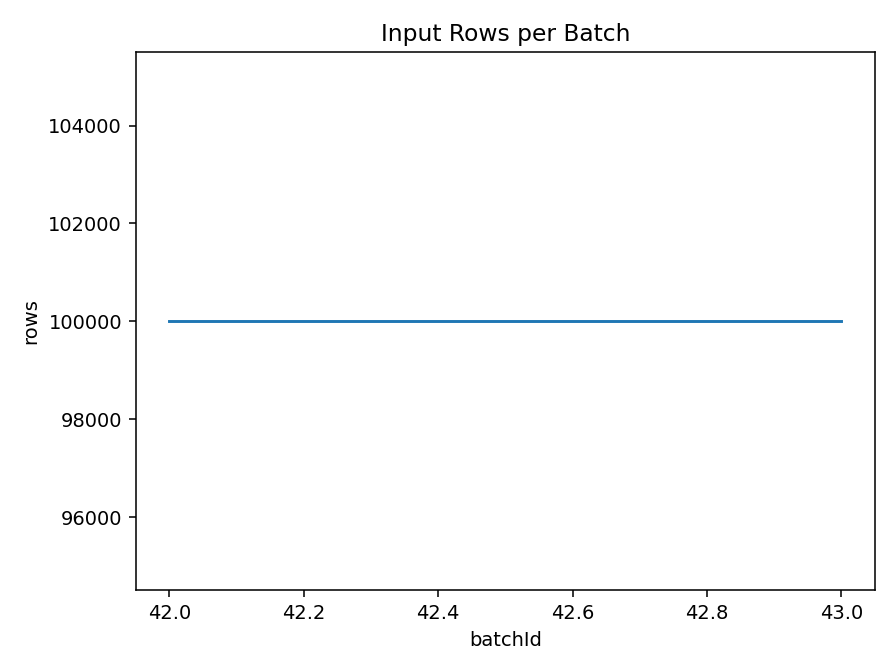
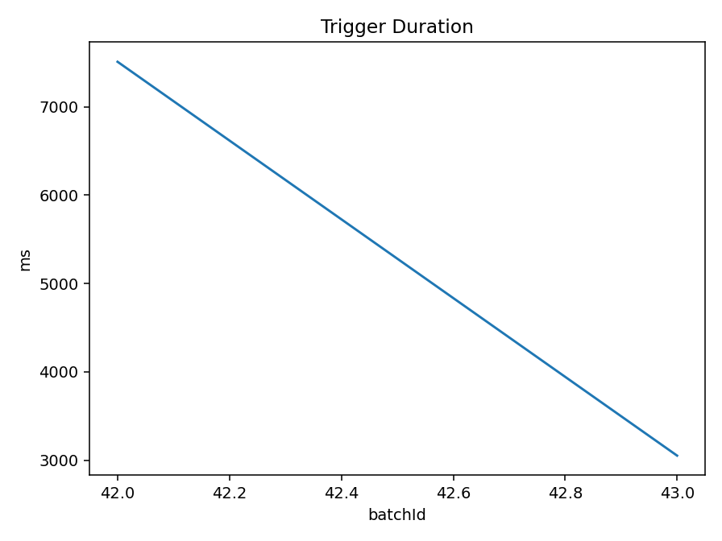

# NASA HTTP Log Analytics — Streaming Replay

A **file-source replay of historical 1995 NASA HTTP logs** using Spark Structured Streaming. It is not a live NASA feed. The socket wordcount exercise is a separate experiment.

[Read the portfolio case study](https://godwineakpan.com/projects/nasa-log-streaming)

## Implemented workflow

1. Release archived `.log` chunks into a watched input directory.
2. Parse log fields and convert timestamp strings, including timezone, to event time.
3. Aggregate status-code counts in one-minute tumbling windows with a configured watermark.
4. Maintain query checkpoints, inspect console output, and export listener progress for analysis.

The recovered scripts include multiple query variants. `6_streaming_nasa_logs.py` uses Complete mode and a two-minute watermark; `nasa_streaming_counts.py` also contains Update/Append and Parquet-sink variants. The report appendix describes a ten-minute watermark and a two-second trigger. These configurations must not be silently treated as one identical run.

## Verified historical observations

The recovered `nasa_metrics.csv` and raw listener JSONL each contain **two batches only**, with matching values:

| Batch | Input rows | Processed rows/s | Trigger duration |
| --- | ---: | ---: | ---: |
| 42 | 100,000 | 13,315.579 | 7,510 ms |
| 43 | 100,000 | 32,765.400 | 3,052 ms |

These are observed batch rates, not sustained throughput, a latency SLA, or end-to-end event latency. The very large first input-rate estimate is not evidence of a multi-million-row/s processing capacity.

## Source and reproduction status

- `notebooks_or_src/6_streaming_nasa_logs.py`: recovered listener-enabled file stream, with local path settings at the top.
- `notebooks_or_src/nasa_streaming_counts.py`: alternative console/Parquet queries; not the canonical verified run.
- `notebooks_or_src/slow_copy_feeder.py`: recovered replay feeder.
- `notebooks_or_src/analyze_stream_metrics.py`: analysis of saved listener progress.
- `results/nasa_metrics.csv`: original two-batch export.

The scripts are archival source snapshots, not a newly validated release. Read the path configuration before execution. Use a compatible Python/Java/PySpark environment; exact versions and hardware have not been fully recovered. Download NASA HTTP logs from the original archive and follow its usage terms. Prepare an input folder, an isolated checkpoint per query, and writable metrics output before starting the feeder and stream. Do not reuse checkpoint state across incompatible query variants.

## Interpretation boundaries

- Complete mode preserves aggregation state; adding `withWatermark` alone does not demonstrate bounded state. [Spark output-mode semantics](https://spark.apache.org/docs/3.5.8/structured-streaming-programming-guide.html#conditions-for-watermarking-to-clean-aggregation-state).
- The recovered trace records zero removed and dropped rows. Its watermark is later than the displayed event times, so it does not validate late-data behaviour.
- The trace reports eight shuffle partitions while one source variant configures four. Record the exact run configuration before reproducing or extending it.
- HTTP status aggregation supports error-trend inspection; an evaluated anomaly detector or production alert service is not established.
- Kafka ingestion and production persistence are proposed extensions. A Parquet-sink variant exists in source, but successful execution is not established by the two console-sink progress records.

## Next iteration

Capture a full trace tied to a source commit and environment; inject late and malformed events; test recovery; measure backlog, p50/p95 trigger duration, and event-to-output lag under defined load.

Academic provenance: Machine Learning on Big Data coursework, October 3, 2025; original logs from the NASA Kennedy Space Center HTTP archive.
