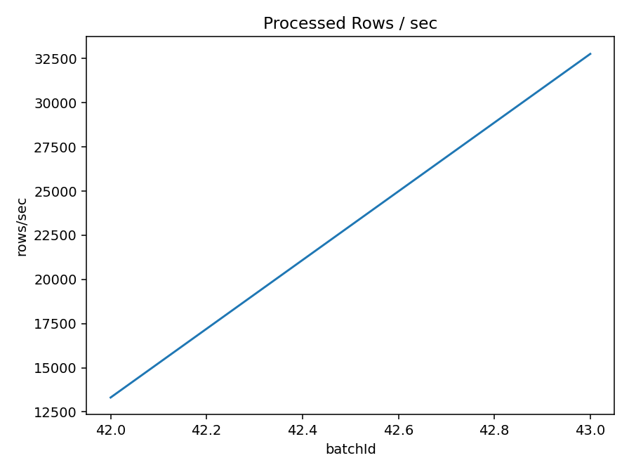

# NASA HTTP Log Analytics

A controlled replay of 1995 NASA web-server logs through Spark Structured Streaming: parse events, aggregate HTTP status codes in event-time windows, and inspect batch timing, throughput, and query state.

[Read the portfolio case study](https://godwineakpan.com/projects/nasa-log-streaming)

## Engineering contribution

Built the file-replay workflow, log parser, event-time aggregation, checkpoint configuration, and metrics analysis for Spark Structured Streaming.

## Workflow

1. **Replay the backlog:** Release historical .log files into an input directory at configured intervals. The replay uses 35 files of roughly 100,000 records each.
2. **Parse the events:** Extract timestamp, request method, path, protocol, and status. Convert the timestamp with its timezone into event time.
3. **Aggregate status codes:** Group requests by one-minute event-time windows and HTTP status, with watermarking configured in the query.
4. **Observe each batch:** Write console output with checkpointing and inspect StreamingQueryListener metrics for input rows, processing rate, duration, watermark, and state.

## Selected results

- **Batch workload — 100,000 rows.** Each of the two instrumented batches processed 100,000 input records.
- **Processing rate — 13,316–32,765 / s.** Observed batch processing rates across the two retained measurements.
- **Trigger duration — 7.510 → 3.052 s.** Query execution duration for those batches, measured separately from event-to-output latency.

Processing rate for two 100,000-row batches. Query metrics make performance visible; longer runs are needed to characterize sustained throughput.

## Engineering decisions

- **Control the arrival stream.** A file feeder releases archived logs at configured intervals, making ingestion conditions easier to inspect and repeat.
- **Model events in event time.** Timestamp parsing and one-minute windows preserve the time of the HTTP event rather than grouping solely by when Spark receives it.
- **Observe execution alongside output.** StreamingQueryListener metrics connect query results with input volume, processing rates, trigger duration, and aggregation state.

## Scope and limitations

- **Measurement window.** The retained trace contains only two batches. It supports batch-level observations, rather than sustained-throughput, percentile-latency, or service-level claims.
- **Event-time and recovery tests.** Complete output mode retains aggregation state despite a configured watermark. Saved variants differ in output mode and watermark delay; late-event handling, bounded state, and restart recovery need controlled tests.
- **Demonstration scope.** The source is a replay of historical NASA logs. Production ingestion, durable downstream delivery, and evaluated anomaly alerts remain extensions.

## Code and reproducibility

Explore the [source snapshots](notebooks_or_src/) and original project figures. These are historical research results; the models and streaming jobs were not rerun for the portfolio presentation.

Selected outputs are in [results](results/). Source availability does not imply a pinned, one-command reproduction; environment versions, input acquisition, and a run manifest should be completed before rerunning.

## Next iteration

1. **Expand the performance trace.** Capture a longer run with environment and query configuration recorded, then summarize steady-state behaviour.
2. **Exercise late data and recovery.** Inject delayed and malformed events, restart from checkpoints, and inspect state size and dropped-row metrics.
3. **Add durable delivery.** Evaluate a persistent sink and Kafka ingestion, with measured end-to-end lag.
