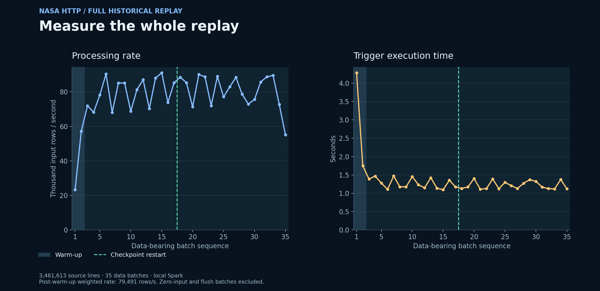
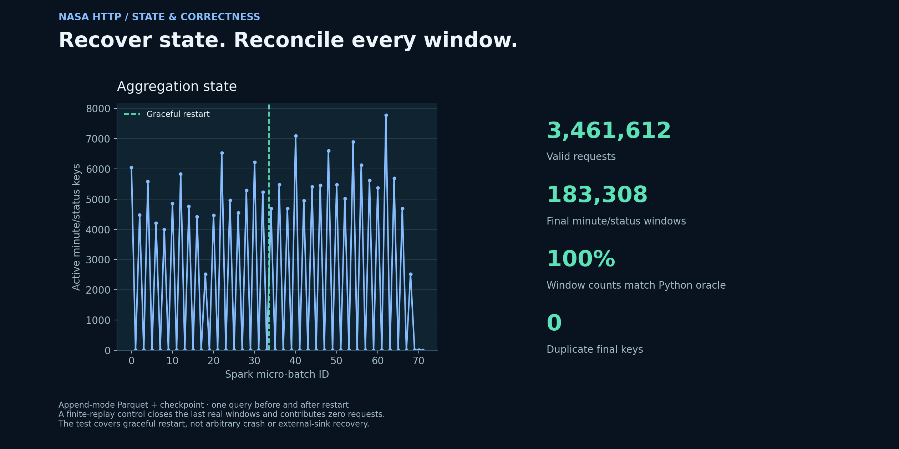
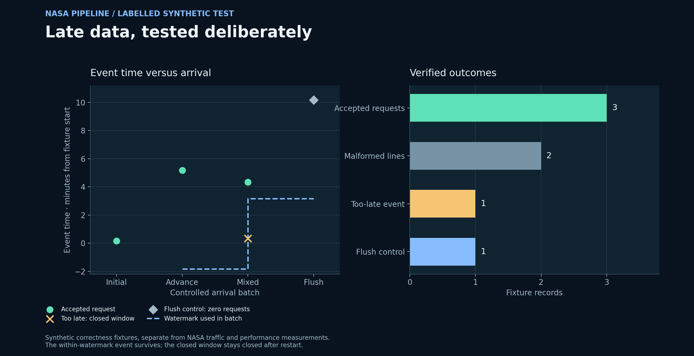
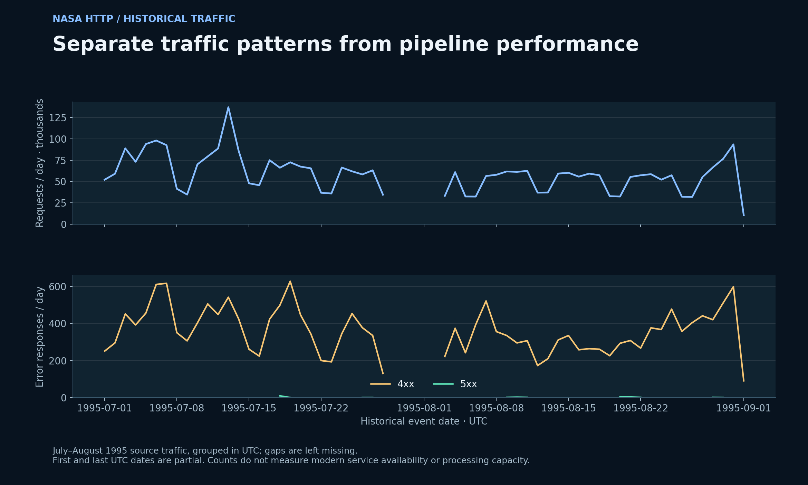

# NASA HTTP Log Analytics

A reproducible Spark Structured Streaming pipeline for historical NASA web-server logs. The corrected implementation combines event-time aggregation, durable Parquet output, complete progress capture, and independently verified recovery and count reconciliation.

[Read the portfolio case study](https://godwineakpan.com/projects/nasa-log-streaming)



## Contribution

- Parsed both July and August source traces: **3,461,613 lines**, **3,461,612 valid requests**, and **1 malformed line**.
- Retained **33,904 unknown byte counts** as null, rather than inventing zero-byte responses.
- Used one-minute event-time windows, a two-minute watermark, and one native append-mode Parquet sink/checkpoint.
- Executed **35 data-bearing batches**, with a graceful checkpoint restart after file 17.
- Reconciled every final minute/status aggregate with an independent Python parser; no duplicate final keys.
- Tested late records, malformed input, and restart behaviour using separate, labelled synthetic fixtures.

## Executed measurements

The replay processes event-time-sorted chunks sequentially; each file is drained before publishing the next. It is a controlled backlog experiment on local Spark, not a live arrival stream or multi-node capacity benchmark.

| Measure | Result |
|---|---:|
| Source lines | 3,461,613 |
| Valid requests reconciled | 3,461,612 |
| Data-bearing batches | 35 |
| Post-warm-up data batches | 33 |
| Post-warm-up weighted processing rate | 79,491 rows/s |
| Post-warm-up trigger p50 | 1.175 s |
| Post-warm-up trigger p95 | 1.459 s |
| Peak aggregation-state keys | 7,783 |
| Final minute/status windows | 183,308 |

The weighted rate is total input rows divided by total trigger-execution seconds for the stated cohort, excluding the first two warm-up batches, all zero-input batches, and the synthetic flush batch. Trigger duration is not event-to-output latency. Replay wall time, which also includes query startup, controlled feeding, and graceful restart, is 81.53 seconds; it is a different measurement. The final source chunk may contain fewer than 100,000 rows.



## Correctness and recovery

All **183,308** final minute/status counts match an independent Python implementation. The full chronological replay dropped no real record by watermark. That deliberately ordered replay does not test realistic arrival disorder; the separate synthetic contract does.

The synthetic sequence verifies: three accepted requests, two malformed lines, one too-late record dropped from a closed window, and one explicit flush control contributing zero requests. A valid event within the watermark allowance survives. Restarting the same query from its checkpoint preserves counts and produces no duplicate final keys. These are controlled fixtures, not statistics about the NASA source traffic.



## Implementation decisions

1. **Explicit parse contract.** Validate common-log structure, timestamp, status 100–599, and byte-size bounds. Preserve timezone offsets and support legacy requests without a protocol token. Malformed rows are counted by reason; unknown bytes stay null. Host and request text do not enter public aggregates.
2. **Deterministic ingestion.** Sort valid historical records by event time, include malformed source rows for the parser audit, create 100,000-line chunks, and atomically publish one file at a time. Sorting is a replay preparation step, not a claim about original arrival order.
3. **One durable query.** Append final window counts to the native Parquet file sink using one checkpoint. Complete mode would retain all aggregate state; the corrected append query can evict state after watermark finalisation.
4. **Inspectable progress.** Persist query progress after every drained file; de-duplicate committed batch IDs across restart. Raw JSONL, which contains local runtime paths, stays private. Public CSVs contain only selected counters and timings.
5. **Explicit finite-input finalisation.** A single synthetic control at maximum real event time plus 240 seconds advances the watermark. It contributes zero to request counts and is excluded from performance summaries. Without new event time, a live idle stream needs a separately designed finalisation policy.

## Reproduce

Use Python 3.11, Java 11, and the pinned `requirements.txt`. Supply the uncompressed July and August NASA logs from the [Internet Traffic Archive](https://ita.ee.lbl.gov/html/contrib/NASA-HTTP.html). Raw logs are not bundled.

```powershell
./run.ps1 -JulyLog /path/to/NASA_access_log_Jul95 -AugustLog /path/to/NASA_access_log_Aug95 -Python python
```

On Windows, configure `JAVA_HOME` and compatible Hadoop native tools (`HADOOP_HOME`) for the selected Spark environment. The wrapper sets process-local Python/Spark paths and temporary storage. Use a fresh private directory for each full reproduction; existing data and checkpoint directories are deliberately preserved.

Equivalent direct sequence:

```bash
python notebooks_or_src/prepare_replay.py --sources /path/to/NASA_access_log_Jul95 /path/to/NASA_access_log_Aug95 --private-dir private-replay
python -m unittest discover -s tests -v
python notebooks_or_src/test_stream_contract.py --private-dir private-replay/contracts --project .
python notebooks_or_src/run_replay.py --private-dir private-replay --project .
python notebooks_or_src/plot_results.py --project .
```

The streaming contracts require local directory access from Java. Some Windows sandboxes block it even when Python can read the same folder; run the unchanged commands from a normal local terminal in that case.

## Evidence

- `results/batch_metrics.csv`: full selected progress trace, including zero-input and flush phases.
- `results/summary.json`: measurement definitions and executed totals.
- `results/parse_quality.csv`: parser accept/reject counts.
- `results/status_counts.csv`, `daily_status_counts.csv`: aggregate historical traffic only.
- `results/stream_contract_tests.json`, `synthetic_contract_metrics.csv`: labelled synthetic outcomes.
- `results/manifest.json`: source hashes, query configuration, environment, and code hashes.
- `results/validation.json`: independent recomputation and verification status.



## Scope and limitations

Throughput depends on this machine, storage, query, and controlled feed. It does not establish sustained live-source capacity, event-to-output latency, or a service-level guarantee. The first two batches are excluded by a fixed rule, not selected to maximise the score. Percentiles describe the small measured batch cohort, not a latency distribution over individual requests.

Tests cover graceful checkpoint restart with unchanged source/schema/sink configuration. Abrupt crashes, corrupt checkpoints, schema migration, and downstream failures are not fault-injected. The native file sink's commit metadata is used for the tested replay; this does not generalise to exactly-once delivery into arbitrary external sinks.

The NASA traces describe historical 1995 requests. Analysis is restricted to general traffic patterns: no host-level investigation, raw host names, or request paths are published. Missing historical dates remain missing in traffic figures. These results supersede the earlier two-batch performance presentation; changed query and execution conditions make direct speedup claims inappropriate.

Dataset provenance and implementation semantics: [REFERENCES.md](REFERENCES.md).
