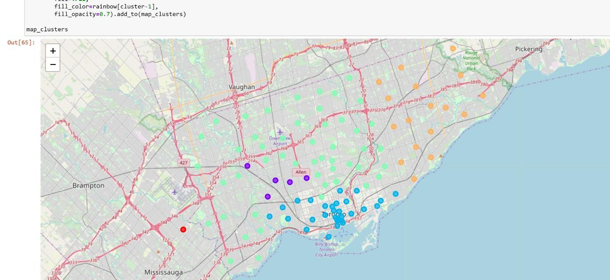
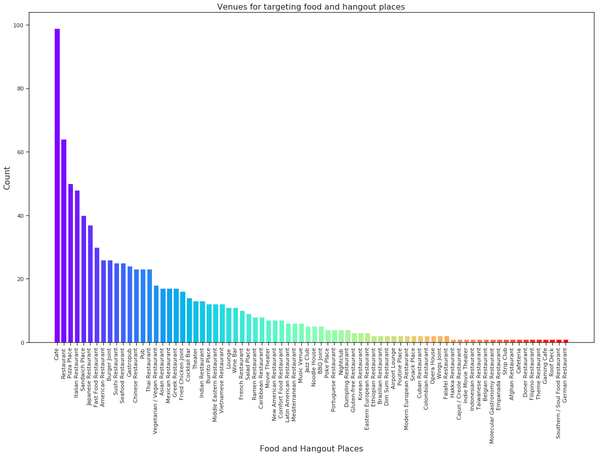

# Toronto Location Intelligence | Web Scraping & Spatial Analysis

Built a location-intelligence workflow combining **web scraping, API integration and geospatial analysis** to explore restaurant-location patterns across the Toronto area.

Extracted postal-code, borough and neighborhood information from Wikipedia using BeautifulSoup, joined geographic coordinates, and collected nearby venues through the Foursquare API. Applied one-hot encoding and K-Means clustering to examine venue composition, presenting the historical results through Folium maps and analytical charts.

The project includes the original cluster map, venue-distribution chart and a reproducible summary of **2,213 returned venue rows across ten area groups**.

**Skills demonstrated:** Python · BeautifulSoup · pandas · Web scraping · API integration · Geographic data preparation · K-Means clustering · Folium · Data visualization

## Original spatial analysis



**[Download or open the historical interactive map](maps/toronto-historical-clusters.html)**

The map preserves 102 postal-code points and their original five-cluster assignments. The model grouped venue composition by the source's area labels; those labels were then joined back onto postal-code points. Points sharing an area therefore share an area-level result. This is an archival capstone map, not a new neighborhood-level clustering run.

GitHub displays the HTML source rather than running the map. Download the HTML file and open it in a browser; internet access is required for the map libraries and OpenStreetMap basemap. The browser view retains the original marker popups.

## Venue composition and sample coverage


Scarborough has the highest Chinese-category share in the saved sample, approximately 5.95%. Coverage differs substantially: the saved area totals range from 12 to 1,296 returned venue rows. The paired chart makes those differences visible alongside the category shares.

Five area groups have a displayed Chinese-category share of zero. That describes the saved search sample, not the absence of restaurants or evidence of unmet demand.

## Original venue-category profile



The original chart summarizes selected food and social-venue categories from the historical capstone workflow. It is preserved as an original analytical output. Its full input table has not been recovered, so its individual bars have not been independently recalculated in this maintenance update. The original text-based category-selection rule also requires review before a fresh analysis.

## Approach and engineering contribution

- Prepared postal-code and coordinate data and collected nearby venue categories using the legacy Foursquare API.
- Explored venue-category composition with one-hot encoding, aggregate comparisons and K-Means; communicated the original results with Folium and Matplotlib.
- Recovered complete saved area totals and Chinese-category shares, reconciled 2,213 returned rows and produced a new share-and-coverage comparison.
- Distinguished postal-code locations from the area-level grouping used by the model, and separated historical observations from later synthetic demonstrations.

The maintained summary script validates the recovered input hash, unique labels, valid shares and row-total reconciliation. [Source code](scripts/analyze_summary.py) and [dependencies](requirements.txt) are included for reproducibility. The original collection and full clustering have not been rerun.

## Data and validation evidence

- [Recovered historical summary CSV](data/historical_area_summary.csv)
- [Original area-total table](evidence/original-cell-53.html)
- [Original category-share table](evidence/original-cell-82.html)
- [Source hashes and artifact provenance](evidence/source-manifest.json)
- [Aggregate validation record](evidence/validation.json)

The main notebook was confirmed against the original private capstone repository. Its saved outputs supply the tables and interactive map; the original map image is retained from the historical portfolio. Table cell indices in the manifest are zero-based. Shares retain the notebook's displayed six-decimal precision; counts have not been inferred from those rounded shares.

## Rerun the maintained summary

Use Python 3.10 or later in an isolated environment. From this project folder:

```powershell
python -m venv .venv
.venv\Scripts\python.exe -m pip install -r requirements.txt
.venv\Scripts\python.exe scripts/analyze_summary.py
```

Expected validation: 10 area rows, 2,213 returned rows and five zero-share groups. The command regenerates the share-and-coverage PNG/SVG and validation JSON. It does not recollect venues, rerun clustering or regenerate the archival map and category chart.

## Scope and limitations

This is a historical learning project. Returned venue rows are not verified unique businesses, search coverage varies, and the exact collection date has not been established. The legacy area labels mix Toronto subdivisions with Mississauga and do not define a consistent municipal boundary.

The complete venue-level export and full category matrix are not available in the recovered snapshot. The original notebook includes separate three-cluster Chinese-category and five-cluster venue-composition analyses; the map above preserves the latter. It should not be interpreted as a freshly validated clustering result.

Later synthetic data demonstrates software behavior only; it does not establish actual demand, saturation, profitability or current site suitability. A new decision-support study would need dated venue records, stable identifiers, consistent boundaries, coverage and duplication checks, cluster-stability assessment, and current demand/cost evidence.
