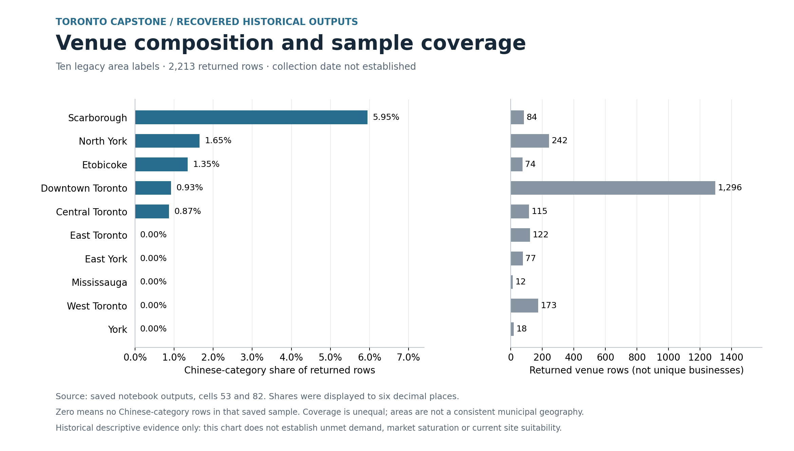

# Toronto location intelligence: historical venue analysis

A recovered IBM Data Science capstone exploring venue composition, geographic grouping and restaurant-location questions. The maintained version makes the historical evidence inspectable and replaces unsupported site-selection claims with a reproducible descriptive summary.

## Verified historical evidence

The original notebook is preserved in the private `Jedidiah82/Capstone-Exercise` repository. Its saved outputs report **2,213 returned venue rows across ten legacy area labels**. This package recovers the complete displayed area totals and Chinese-restaurant category shares from those outputs.



Scarborough has the highest Chinese-category share in this saved sample, approximately 5.95%. Five area labels have a displayed share of zero. These observations describe the returned sample; they do not establish population-wide restaurant density, demand, saturation, profitability or recommended sites.

## Inspect the evidence

- [Recovered aggregate CSV](data/historical_area_summary.csv)
- [Saved area-total table, original cell 53](evidence/original-cell-53.html)
- [Saved category-share table, original cell 82](evidence/original-cell-82.html)
- [Source hashes and recovery boundaries](evidence/source-manifest.json)
- [Latest aggregate validation](evidence/validation.json)
- [Reproducible validation and figure script](scripts/analyze_summary.py)

Cell indices are zero-based. Category shares retain the notebook's displayed six-decimal precision; raw category counts have not been inferred from rounded shares. Returned rows can include the same venue from overlapping searches and are not verified unique businesses.

## What changed

- Replaced the violin plot of one aggregate value per area with an aligned share-and-coverage comparison.
- Corrected the analytical grain: the original collection passed `Borough` values into a field called `Neighborhood`. Its later clustering pooled rows by those labels.
- Removed claims that synthetic data preserves real business conclusions. The later synthetic reconstruction randomly assigns coordinates and categories and uses nine categories, whereas the original saved grouped output reports 266 category columns.
- Removed the placeholder interactive-map link. No corrected neighborhood cluster map or fresh clustering result is claimed.

## Reproduce the maintained summary

Use Python 3.10 or later in an isolated environment:

```powershell
python -m venv .venv
.venv\Scripts\python.exe -m pip install -r requirements.txt
.venv\Scripts\python.exe scripts/analyze_summary.py
```

The script checks the recovered input hash, unique area labels, valid shares, positive sample sizes and the 2,213-row reconciliation. It writes PNG/SVG figures and a fresh `evidence/validation.json`, including its run time and environment. It makes no network calls and requires no API credentials. This regenerates the historical summary; it does not rerun the original data collection or clustering.

## Sources and method

The original notebook references the Wikipedia list of Canadian M postal codes, the `cocl.us/Geospatial_data` coordinate file and the legacy Foursquare v2 venue-explore endpoint. Its collection code specifies a 500 m search radius and a 100-result limit. The API version string `20180605` is not evidence of the collection date. The current availability and coverage of those historical services have not been validated here.

The original methods include venue-category one-hot encoding, category-share aggregation, a three-cluster comparison using Chinese-category shares and a separate five-cluster comparison using the category matrix. These are historical methods, not newly verified model results. The complete venue dataset and category matrix have not been recovered from the archive; displayed previews omit records and columns.

## Limitations and next analytical step

The legacy labels mix Toronto subdivisions with Mississauga and do not define a consistent municipal study boundary. Sampling coverage varies markedly, search responses may be capped, and venue identifiers are unavailable for full deduplication. Zero returned Chinese-category rows do not mean that an area had no Chinese restaurants. No calibrated uncertainty, current demand, rent, footfall or business outcomes are supplied.

A defensible new site-selection study needs a permitted, dated venue dataset with identifiers, explicit geographic units and boundary, spatial deduplication, collection-coverage checks, and demand/cost evidence. Clustering should then be assessed for sensitivity to feature choices, number of clusters and random seeds. Synthetic fixtures can test software behavior separately; they cannot validate current market recommendations.

Legacy images in `figures/` are retained for historical continuity. Only the figure embedded above is regenerated and supported by this maintained summary. Original notebooks and credential-bearing outputs are excluded from this public update.
