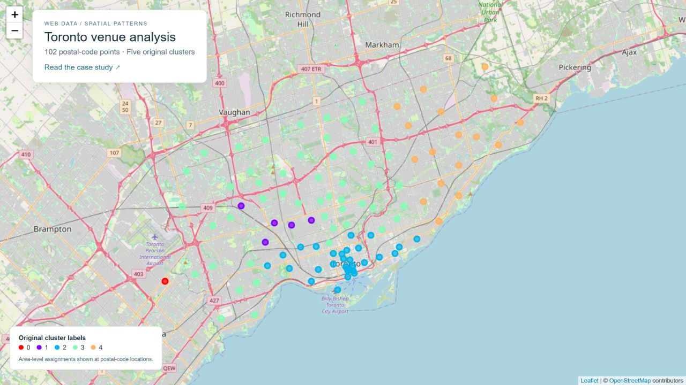
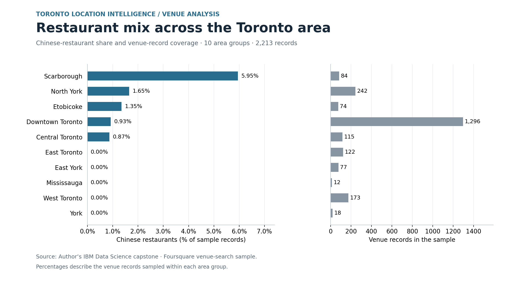

# Toronto Location Intelligence | Web Scraping & Spatial Analysis

Built a location-intelligence workflow combining **web scraping, API integration and geospatial analysis** to explore restaurant-location patterns across the Toronto area.

Extracted postal-code, borough and neighborhood information from Wikipedia using BeautifulSoup, joined geographic coordinates, and collected nearby venues through the Foursquare API. Applied one-hot encoding and K-Means clustering to examine venue composition, presenting the historical results through Folium maps and analytical charts.

The project brings together **2,213 sampled venue records, ten area groups and a 102-point cluster map**.

**Skills demonstrated:** Python · BeautifulSoup · pandas · Web scraping · API integration · Geographic data preparation · K-Means clustering · Folium · Data visualization

## Toronto venue clusters



**[Open interactive map](https://godwineakpan.com/projects/toronto/historical-map)** · [Read the portfolio case study](https://godwineakpan.com/projects/toronto-location-intelligence) · [Download map HTML](maps/toronto-historical-clusters.html)

Explore five venue-composition clusters across 102 postal-code locations in the Toronto area. Select a marker in the interactive map to inspect its label.

## Restaurant mix across the Toronto area



Compare Chinese-restaurant representation and venue-record coverage across ten area groups. Scarborough has the highest Chinese-restaurant share in the capstone sample, approximately **5.95%**. Record totals range from **12 to 1,296**, providing context for the category comparison.

## Food and social-venue profile


The capstone’s category profile shows the mix of cafés, restaurants and other food and social venues in the collected sample.

## From web data to spatial insight

1. **Scrape geographic reference data:** extract and clean postal codes, boroughs and neighborhood names with requests and BeautifulSoup.
2. **Integrate coordinates:** join a public latitude/longitude table by postal code.
3. **Collect venue observations:** query nearby venues through the Foursquare explore API using a 500 m search radius and a 100-result limit.
4. **Engineer and cluster features:** one-hot encode venue categories, aggregate category shares and apply K-Means to explore similarities.
5. **Communicate spatial patterns:** join cluster labels to postal-code points and present the results with Folium maps and Matplotlib charts.

## Code and reproducibility

The public [Python summary script](scripts/analyze_summary.py) validates source fingerprints, area labels, numeric ranges and the 2,213-record reconciliation, then regenerates the restaurant-mix chart.

Use Python 3.10 or later. From this project folder:

```powershell
python -m venv .venv
.venv\Scripts\python.exe -m pip install -r requirements.txt
.venv\Scripts\python.exe scripts/analyze_summary.py
```

Expected validation: **10 area rows, 2,213 venue records and five zero-share groups**. Outputs: `figures/restaurant-mix.png`, `figures/restaurant-mix.svg` and `evidence/validation.json`.

## Methodology and limitations

This is a historical IBM Data Science capstone. The original model pools venue observations by legacy area labels; its cluster assignments are then mapped to postal-code locations. The markers therefore display area-level results, not independently learned neighborhood clusters. The original notebook also contains a separate three-cluster analysis of Chinese-category shares; the displayed map uses the five-cluster venue-composition analysis.

The labels mix Toronto subdivisions with Mississauga. Sampling coverage varies, search responses may be capped and overlapping queries may repeat businesses. Venue records are not verified unique businesses. A zero share means no Chinese-category records in that saved sample, not that an area had no Chinese restaurants. The exact collection date is not established.

The original map and venue-category chart are saved capstone outputs. The complete venue export and category matrix have not been recovered, so the full clustering and individual bars in the original category chart have not been independently rerun. The maintained summary uses the complete saved area-total and Chinese-share tables; shares retain their six-decimal displayed precision. Its validation covers aggregate recovery and figure generation.

Synthetic examples can demonstrate software behavior but do not validate real demand or market opportunities. Current site recommendations would require a dated, deduplicated venue dataset, consistent geographic units, cluster-stability checks and current demand/cost evidence.

## Source and validation records

- [Historical aggregate CSV](data/historical_area_summary.csv)
- [Saved area-total table](evidence/original-cell-53.html)
- [Saved Chinese-category share table](evidence/original-cell-82.html)
- [Source manifest and hashes](evidence/source-manifest.json)
- [Aggregate validation record](evidence/validation.json)

The map and original category chart come from the author's IBM Data Science capstone; the restaurant-mix chart uses its saved aggregate tables. Source references in the notebook include Wikipedia's Canadian M postal-code table, the public geospatial-coordinate CSV and the legacy Foursquare explore API.
