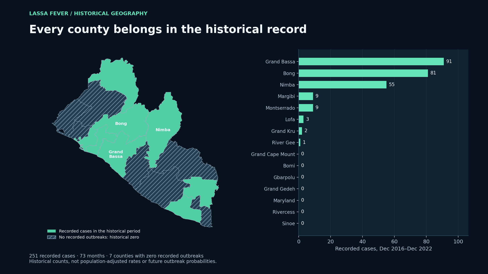
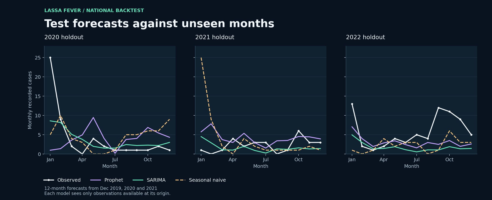
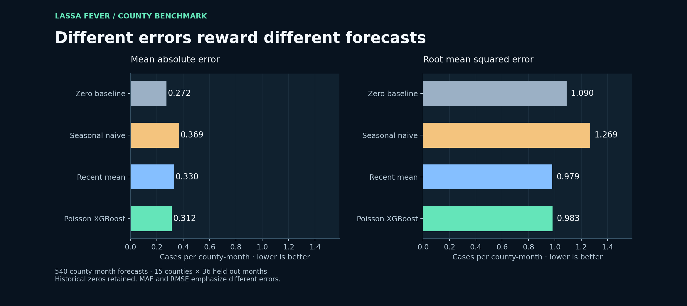

# Lassa Fever Surveillance Forecasting — Liberia

Reproducible monthly surveillance analysis combining national seasonal forecasting, county count models, and GIS. The study asks whether forecasting methods improve on simple baselines when case reporting is sparse.



## Contribution

- Complete 15-county panel with 73 observed months, December 2016–December 2022.
- Three annual rolling-origin backtests; 36 held-out national months and 540 county–months.
- Training-only features, recursive prediction, count-aware modelling, and explicit baseline comparisons.
- Historical zeros retained for seven counties with no recorded outbreaks; unknown future outcomes never filled with zeros.

## Executed results

Run: 18 October 2026. Lower error is better; MAE selects models. National and county scores measure different aggregation levels and should not be compared directly.

| Level | Model | MAE | RMSE |
|---|---|---:|---:|
| National | Prophet | 3.825 | 5.667 |
| National | SARIMA | 3.040 | 4.570 |
| National | Seasonal naive | 4.361 | 6.764 |
| County | Poisson XGBoost | 0.312 | 0.983 |
| County | Recent mean | 0.330 | 0.979 |
| County | Seasonal naive | 0.369 | 1.269 |
| County | Zero baseline | 0.272 | 1.090 |

SARIMA reduced pooled national MAE by about 30% against seasonal naive, although it did not win every year. At county level, the zero baseline had the lowest MAE; recent mean had the lowest RMSE. Poisson XGBoost improved RMSE against zero prediction but did not outperform every baseline. These tradeoffs are central results.





## Evaluation design

Train through December 2019, 2020, and 2021; forecast the following 12 months. The additional 2021–2022 holdout overlaps the annual folds and is not independent evidence. National candidates are seasonal naive, SARIMA (1,0,1)×(1,0,1,12), and Prophet with yearly seasonality. County candidates are zero, seasonal naive, recursive three-month recent mean, and pooled Poisson XGBoost.

County predictors use lagged counts (1, 2, 3, 12 months), shifted rolling means (3, 6 months), month sine/cosine, and county indicators. Recursive forecasts use preceding predictions, never held-out actuals. Hyperparameters are fixed before evaluation. SARIMA convergence is checked; diagnostics retain fitting details. National predictions and interval endpoints are bounded below at zero.

## Scope and limitations

Recorded cases depend on surveillance ascertainment. A recorded zero does not demonstrate absence of infection. Maps show count history, not population-adjusted risk. The 73-month series and three origins limit generalisation. SARIMA's nominal 95% band covered 32/36 held-out months (88.9%); county uncertainty is not calibrated. The national and county models are not hierarchically reconciled.

Projections for 2023–2026 originate in December 2022 and have not been verified against later observations. Treat them as historical-origin scenarios, not current operational forecasts. Forecast performance does not establish clinical utility or response effectiveness.

## Reproduce

Use Python 3.11 and `pip install -r requirements.txt`. Run commands from this project directory:

```bash
python -m unittest discover -s tests -v
python Scripts/make_synthetic_example.py --output data/example_synthetic.csv
python Scripts/lassa_forecasting_pipeline.py --input data/example_synthetic.csv --output synthetic-run --private-output private-synthetic
```

The example is synthetic and will not reproduce the surveillance scores above. The study's observed inputs and row-level backtest files are not redistributed. To reproduce those scores, supply an authorised aggregate CSV with `date,county,cases`, one nonnegative integer count per county per month, continuous month-end dates, and an observed end of December 2022. Do not append unknown future targets. `Scripts/prepare_aggregate_inputs.py` supports the original aggregate-export schema and validates national–county reconciliation; its zero-fill policy applies only to the confirmed complete county roster.

Prophet uses a native Stan executable. If a Windows sandbox blocks it, run the same command in a normal local terminal. Runtime failures are recorded and never replaced with historical scores; all models completed in the published run.

`Scripts/plot_results.py --help` documents figure generation from authorised aggregate inputs, private predictions, and county boundaries. Boundary geometry is not bundled. The published figures were regenerated from the executed run. `results/manifest.json` records input and source hashes and package versions; `results/diagnostics.json` records model diagnostics.

## Outputs

- `results/backtest_summary.csv`: pooled annual metrics.
- `results/national_metrics.csv`, `county_metrics.csv`: evaluation breakdowns.
- `results/county_backtest_summary.csv`: county-level error summaries.
- `results/national_projections.csv`, `county_projections.csv`: historical-origin model scenarios.
- `Figures/`: regenerated figures, including mobile layouts and projection scope.

The corrected implementation supersedes earlier training-fit county scores and the earlier single-holdout model comparison. Results reported here belong to this version and evaluation design.
