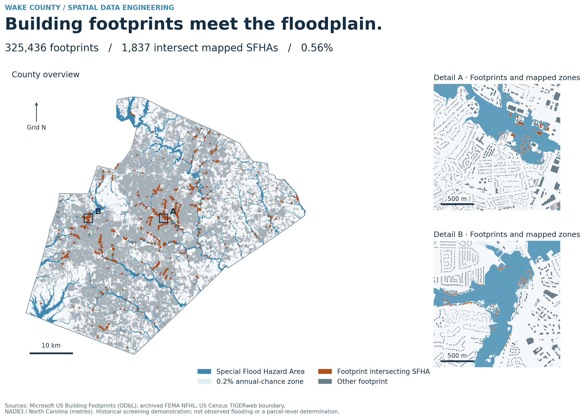
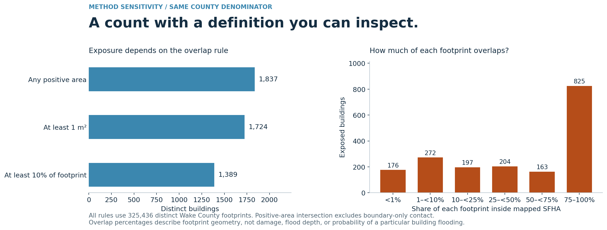

# Wake County Building Exposure & Spatial QA

A reproducible GIS engineering study connecting Microsoft building footprints, a US Census county boundary and an archived FEMA National Flood Hazard Layer extract. The workflow makes the study population, geometry checks and exposure definition explicit, then independently reconciles the results.

**Independent portfolio demonstration by Godwin Etim Akpan. Not commissioned by, affiliated with, or an operational product of NC Emergency Management.**



## Results from the corrected rerun

| Measure | Verified result |
|---|---:|
| Distinct Wake County footprints | 325,436 |
| Footprints with positive-area intersection with mapped SFHA | 1,837 |
| Share of county footprints | 0.564% |
| Small footprints retained and flagged (<30 m²) | 645 |
| County-assigned footprints crossing the county boundary | 60 |

These are historical geometric exposure indicators, not observed floods, insured losses, damage estimates or current building inventories. A building outside the selected SFHA is not established to be free of flood risk.

## The engineering

1. Stream the original 4,678,064-feature North Carolina GeoJSON without loading the statewide dataset into memory. Retain candidate IDs tied to source row order and the source SHA-256.
2. Assign buildings to Wake County (GEOID 37183) using an interior representative point covered by the county boundary. Retain complete building geometry; record boundary-crossing cases.
3. Measure in NAD83 / North Carolina, **EPSG:32119 (metres)**. Validate and repair polygonal geometry, remove unusable features and exact normalized-geometry duplicates, and flag small footprints without automatically removing them.
4. Clip FEMA polygons to the same county. Select **SFHA_TF = T**, retaining FEMA zone attributes. The archived county layer contains A and AE SFHAs; X zones, including future-conditions and 0.2% annual-chance zones, are excluded from the primary SFHA count.
5. Calculate positive-area intersections, dissolve by original building ID, and count each building once. Boundary-only contact does not count; overlapping hazard polygons cannot inflate footprint overlap area.
6. Reconcile the exposure flags against a dissolved hazard independently. Reopen saved outputs, verify geometry/ID/count/area contracts and independently recalculate a deterministic sample of overlap areas.



The sensitivity figure compares positive-area, at-least-1-m² and at-least-10%-of-footprint definitions using the same county denominator. The two atlas detail windows are selected deterministically from high-count 2 km cells separated by at least 6 km; they illustrate the geometry rather than rank neighbourhood risk.

## Reproduce

Python 3.11 was used for this rerun. Work from this project directory. The full original building GeoJSON and FEMA GeoPackage are not bundled in this update; see [input provenance and hashes](docs/DATA-SOURCES.md).

```powershell
py -3.11 -m venv .venv
.\.venv\Scripts\python.exe -m pip install -r requirements.txt
.\.venv\Scripts\python.exe scripts/test_pipeline.py
$source = 'C:\path\to\original\BuildingFootprint_Demo_NCEM'
.\.venv\Scripts\python.exe scripts/pipeline.py --source "$source" --boundary data_reference/wake-county-tigerweb.geojson --output rerun --cache cache
.\.venv\Scripts\python.exe scripts/validate_outputs.py --run rerun
.\.venv\Scripts\python.exe scripts/figures.py --run rerun --output rerun/figures
```

Stop if any command exits nonzero. Confirm `rerun/run_manifest.json` says `SUCCESS` and `rerun/validation.json` says `PASS`. An existing JSON from an older run is not evidence that a new run succeeded: use a new output directory per run and check timestamps and input hashes. The pipeline uses a hash-keyed extraction cache; changing an input invalidates that cache.

`BuildingFootprint_FloodExposure_NCEM.ipynb` is an executed, portable results companion. It reads the included aggregate results and figures; full spatial computation is performed by the commands above. No notebook execution is needed to view the published figures.

## Repository guide

| Path | Purpose |
|---|---|
| `scripts/pipeline.py` | Streaming extraction, county selection, QA and flood exposure |
| `scripts/test_pipeline.py` | Synthetic contracts: duplicate overlaps, touches, slivers and geometry handling |
| `scripts/validate_outputs.py` | Saved-spatial-output reconciliation |
| `scripts/figures.py` | Offline atlas, mobile details and sensitivity figures |
| `scripts/fetch_boundary.py` | Optional new official boundary snapshot, with metadata; refuses overwrites |
| `results/` | Executed summaries, QA, manifests, logs and validation |
| `data_reference/` | Packaged county boundary and service provenance |
| `docs/` | Data lineage, corrections and rerun details |
| `figures/` | PNG/PDF publication figures and figure-selection metadata |

The original `data_raw`, `data_clean`, `hazards` and older figure files are historical artifacts. **The corrected results are in `results/`; the corrected spatial outputs are created under your chosen rerun directory.** Legacy entry points now explain the replacement commands rather than silently execute the superseded workflow.

## Scope and limitations

- The original download URL/retrieval date and complete source metadata were not preserved. The footprint capture-date attributes are retained, and exact local source hashes are recorded; this does not establish a current 2026 inventory.
- The FEMA extract identifies DFIRM 37183C and a database modification date of 2025-07-18. This is not independently established as the effective date of every polygon. Its companion metadata file is a placeholder. Results are tied to that archived extract rather than advertised as current regulatory determinations.
- The county boundary is a US Census TIGERweb January 1, 2026 snapshot. Different source vintages, positional accuracy and county-edge assignment can change marginal intersections.
- Geometric QA establishes computational consistency, not independently surveyed building completeness or positional accuracy. Near-boundary slivers remain sensitive to source alignment; sensitivity counts make this visible.
- Five retained building representative points fall outside the archived FEMA polygon coverage. They remain in the county inventory and are flagged in spatial outputs; absence from the selected SFHA is not treated as evidence of safety.
- The analysis covers building footprints without occupancy, population, building use, floor elevation or vulnerability attributes. It does not identify critical infrastructure or quantify people at risk.
- The completed analysis is flood exposure. Surge, wildfire and tornado analysis have not been implemented or validated in this release.

## Attribution

Footprints: [Microsoft US Building Footprints](https://github.com/microsoft/USBuildingFootprints), [ODbL data licence](https://github.com/microsoft/USBuildingFootprints/blob/master/LICENSE-DATA). Boundary: [US Census TIGERweb Counties](https://tigerweb.geo.census.gov/arcgis/rest/services/TIGERweb/State_County/MapServer/1). Hazard: archived FEMA NFHL supplied with the original project. Maps and analytical workflow: Godwin Etim Akpan. Derived spatial databases retain the source-data licence obligations; this update publishes aggregates and produced maps, not the full footprint database.
