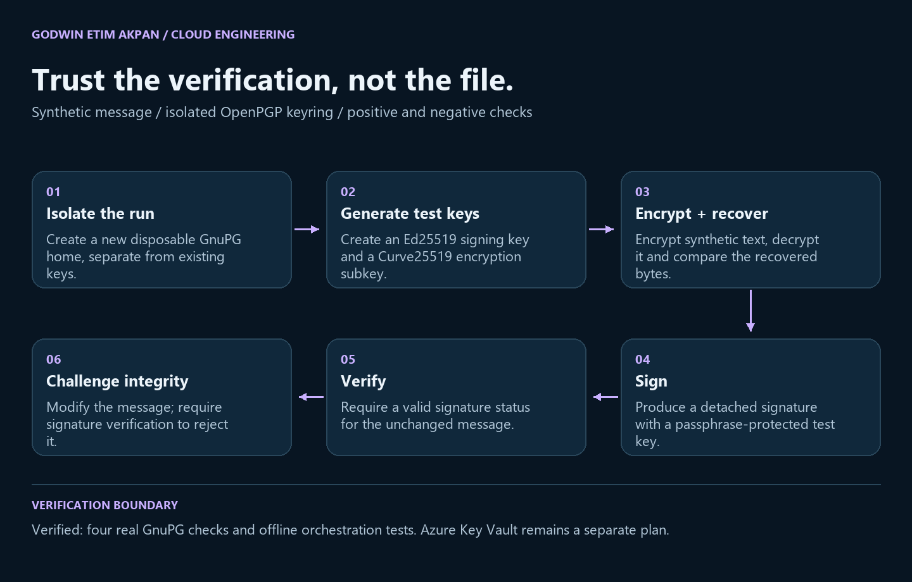

# Applied Cryptography

**Verify the original. Reject the altered.**

An isolated OpenPGP exercise that encrypts and recovers a synthetic message, verifies a detached signature and rejects a modified copy. Each run uses a disposable keyring separate from personal keys and publishes only a compact verification report.



## What was implemented

- **Isolate the keyring** — Create a new GnuPG home for each run, with short-lived signing and encryption test keys.
- **Encrypt and recover** — Use the encryption subkey and compare the decrypted synthetic message with the original bytes.
- **Sign and verify** — Create a detached signature and require GnuPG to emit a valid-signature status for the original message.
- **Reject modification** — Change the message and require a failing verification result with a bad-signature status.

## Validation and evidence

Four real GnuPG checks passed with GnuPG 2.4.8. Five offline orchestration tests also passed. Key Vault was not executed.

- **GnuPG execution: 4 / 4 passed** — GnuPG 2.4.8 confirmed plaintext recovery, decryption status, a valid signature and rejection of a modified message.
- **Failure contracts: 5 passed** — Offline tests check existing-directory refusal, missing executables, failed key generation, isolated command orchestration and incorrect tamper acceptance.
- **Azure Key Vault: Plan only** — A separate helper documents operations for an existing approved key; no new Azure calls or role grants were made.

See [evidence/validation.json](evidence/validation.json) and [the executed test log](evidence/local-tests.txt). Test counts refer to local tests, not proof of production readiness.

## Run it

Python 3.10+ and official GnuPG/Gpg4win are required. The executed run used GnuPG 2.4.8. No third-party Python library is required.

```sh
python -m unittest -v
python verify_openpgp.py --private-dir ../../../private-openpgp-UNIQUE-RUN --report evidence/openpgp-result.json
python keyvault_plan.py --vault example-vault --key example-key
```

Choose a NEW private directory outside the repository and upload package for each real run; replace UNIQUE-RUN with a unique value. Existing directories are refused. The runner creates one-day test keys and synthetic text. It passes a random in-memory passphrase through stdin and never touches your default keyring. The private directory retains disposable key material; do not upload it. The public JSON includes no private keys or passphrase. On Windows, run outside a restricted client if GnuPG fails with a DLL relocation error; a blocked executable is a failed run, not a successful verification. The prepared local launcher verifies a fresh report before printing SUCCESS.

The Key Vault helper prints command arrays only. It does not authenticate, create a vault, grant roles or invoke Azure. If separately approved, use an existing suitable RSA key and inspect its key type, version, protection and allowed operations before using the commands. Compare recovered synthetic plaintext and separately test denial for an unauthorized identity. Record the exact key version so rotation cannot silently change the experiment. Do not infer HSM backing from the service name or infer application least privilege from assigning a broad Crypto Officer role. Large-file encryption would require an envelope design; the sample RSA operation is for a small message. Public-key encryption alone does not authenticate a sender, and signatures alone do not implement replay prevention.


## Files and output mapping

- verify_openpgp.py — isolated execution and sanitized result report
- test_openpgp.py — offline failure-path tests
- evidence/openpgp-result.json — fresh, executed cryptographic checks
- keyvault_plan.py — plan-only extension for an existing approved Azure key
- docs/architecture.svg, architecture-mobile.svg and architecture.png — original diagrams of this implementation.

## Scope and limitations

- **A functional cryptography exercise** — This is not a cryptographic audit, identity-verification service or compliance certification.
- **Test keys are disposable** — One-day synthetic test keys and process-memory passphrases are not a production key backup, rotation or recovery policy.
- **Replay is a separate threat** — Encryption and signatures do not by themselves prevent replay. Nonces, timestamps and application-side replay handling would need separate design and tests.

## Next technical priorities

- **Verify the cloud extension separately** — In an approved vault, record the key type, version and operations; test an authorized operation and a denied unauthorized request.
- **Add an application trust model** — Define identity binding, key distribution, rotation, revocation and recovery before applying this pattern to real data.

## References

- https://www.gnupg.org/documentation/manuals/gnupg/Unattended-Usage-of-GPG.html
- https://learn.microsoft.com/en-us/cli/azure/keyvault/key?view=azure-cli-latest
- https://learn.microsoft.com/en-us/azure/key-vault/keys/about-keys-details

## Author

Godwin Etim Akpan · Geospatial & Data Engineer
