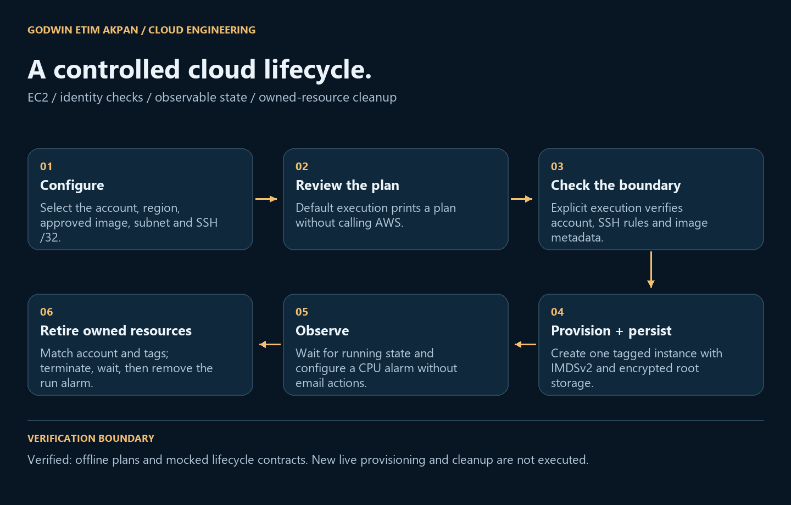

# AWS Infrastructure Lifecycle

**Make every resource accountable.**

A CLI-driven EC2 lab with reviewable offline plans, explicit execution, account and network checks, recoverable state and ownership-based cleanup. Historical AWS screenshots provide context; new lifecycle tests exercise the control logic without provisioning resources.



## What was implemented

- **Review configuration** — Supply an approved account, region, Amazon Linux image, subnet, key pair and a security group limited to the administrator IPv4 /32.
- **Inspect an offline plan** — The default command prints arguments and makes no AWS calls. This is not AWS API DryRun validation.
- **Execute deliberately** — Explicit execution checks account identity, security-group ingress and supported image metadata before launching one instance.
- **Track and retire** — Save state, wait for running, configure a CPU alarm; cleanup checks account and tags before termination and alarm removal.

## Validation and evidence

Offline command construction and mocked AWS responses were tested. No new cloud provisioning, IAM changes or termination occurred.

- **Offline lifecycle contracts: 14 passed** — Tests reject account mismatches, foreign tags, open SSH, unsupported administrator ranges and missing ingress; they check recovery state and cleanup ordering.
- **Historical execution: Preserved** — Original EC2, SSH, IAM and CloudWatch screenshots remain available as historical evidence.
- **New AWS deployment: Not executed** — The new runner has not been verified against live AWS resources. The offline plan and mocked calls establish code behavior only.

See [evidence/validation.json](evidence/validation.json) and [the executed test log](evidence/local-tests.txt). Test counts refer to local tests, not proof of production readiness.

## Run it

Python 3.10+ is required for local tests and plans. AWS CLI v2 and a separately approved, authenticated sandbox are needed for live execution. No Python cloud SDK is required.

```sh
python -m unittest -v
python lifecycle.py create --config config.example.json
```

The example identifiers are placeholders. The plan is pure local command construction: no AWS calls, permission check or billable resources. For an approved live run, copy the example to `config.local.json` and replace every placeholder. Choose an x86_64 EBS-backed Amazon Linux image with `/dev/xvda` root, an approved subnet, an existing key pair and an existing security group whose only ingress is TCP/22 from your approved IPv4 /32. Confirm the actual VPC routes, public/private access design, egress rules and AMI block-device settings separately. These checks do not establish a complete network security posture.

```sh
# These commands ACT on AWS resources and can incur charges.
python lifecycle.py create --config config.local.json --state state.local.json --execute
python lifecycle.py status --config config.local.json --state state.local.json --execute
python lifecycle.py cleanup --config config.local.json --state state.local.json --execute
```

Use a unique run_id for each intended instance. State is saved before the waiter and alarm calls. If a later step fails, keep the state and use status/cleanup; do not delete the state and launch again to make the failure disappear. Account and ownership checks protect the cleanup target. Preserve failed-run logs privately and reconcile actual AWS resources. If state creation itself fails after the AWS launch, locate the instance by Project and RunId tags before retrying.

No IAM user, policy, key pair, subnet, security group or role is created by the runner. Keep MFA enabled and use appropriately scoped short-lived credentials; administrator access is not required by this example. Required operations include STS GetCallerIdentity, EC2 DescribeImages/DescribeSecurityGroups/RunInstances/CreateTags/DescribeInstances/TerminateInstances and CloudWatch PutMetricAlarm/DeleteAlarms, with account-specific restrictions. This is an operation inventory, not a complete least-privilege IAM policy. The alarm has no SNS/email actions, and alarm creation does not prove a threshold was triggered. Encrypted EBS and alarm charges may apply. Verify termination, alarm removal, remaining volumes and billing after the run. Existing network and identity resources are deliberately retained.


## Files and output mapping

- lifecycle.py — offline plans and explicit lifecycle execution
- test_lifecycle.py — account, network, recovery and ownership contracts
- config.example.json — intentionally nonfunctional example identifiers
- screenshots/ — preserved historical EC2, SSH, IAM and CloudWatch evidence
- docs/architecture.svg, architecture-mobile.svg and architecture.png — original diagrams of this implementation.

## Scope and limitations

- **Cloud integration remains separate** — Current IAM permissions, AMI availability, network reachability and successful live cleanup require an authorized account run.
- **A single-instance lab** — No high availability, autoscaling, private-subnet design, comprehensive IAM policy or production security assessment is claimed.
- **Cost and cleanup boundaries** — The runner terminates its tagged instance and deletes its run alarm. Existing keys, subnets and security groups are retained; other charges must be checked separately.

## Next technical priorities

- **Capture a controlled live run** — Use an approved sandbox account, record a sanitized lifecycle transcript and verify the final instance and alarm states.
- **Move toward declarative infrastructure** — Introduce reviewed Terraform or CloudFormation after the intended network and identity model is established.

## References

- https://docs.aws.amazon.com/cli/latest/reference/ec2/run-instances.html
- https://docs.aws.amazon.com/cli/latest/reference/ec2/terminate-instances.html
- https://docs.aws.amazon.com/AWSEC2/latest/UserGuide/configuring-instance-metadata-service.html

## Author

Godwin Etim Akpan · Geospatial & Data Engineer
