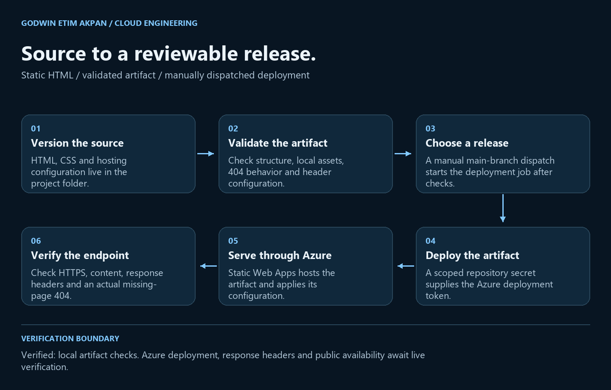

# Azure Static Delivery

**Small artifact. Traceable release.**

A rebuilt static application with versioned hosting configuration, automated local checks and a manually dispatched Azure deployment workflow. The design makes the source artifact inspectable and keeps deployment credentials outside browser-delivered files.



## What was implemented

- **Version the artifact** — Keep the HTML, external CSS, 404 page and Static Web Apps configuration together.
- **Validate locally** — Check document structure, local links, security-header configuration and the custom 404 mapping.
- **Choose deployment** — Automatic push and pull-request jobs validate only. A main-branch manual dispatch enables the deployment job.
- **Verify the served endpoint** — After deployment, test HTTPS, expected content, actual headers and a random missing-page response.

## Validation and evidence

The rebuilt static artifact passed local checks. Cloud deployment and endpoint behavior are pending separate verification.

- **Artifact validation: 5 passed** — Local checks cover documents, asset references, header configuration, 404 mapping and simple client-secret indicators.
- **Publishable source: Rebuilt** — The previously missing static application and workflow are included with commands for local preview and release.
- **Live Azure endpoint: Unverified** — No active deployment badge or placeholder demo URL is presented. Historical screenshots are retained with their limited scope.

See [evidence/validation.json](evidence/validation.json) and [the executed test log](evidence/local-tests.txt). Test counts refer to local tests, not proof of production readiness.

## Run it

Python 3.10+ suffices for local validation and preview. The rebuilt artifact has no .NET, Node or frontend-package dependency.

```sh
python validate_static.py
python -m http.server 8094 --directory static --bind 127.0.0.1
```

Open `http://127.0.0.1:8094/`. Python's simple server serves the files but does not apply Azure's hosting headers or 404 rewrite. Stop with Ctrl+C.

For GitHub, place the supplied workflow at repository root `.github/workflows/azure-portfolio-lab.yml`. A workflow nested inside this project folder will not run. The workflow checks the artifact on relevant pushes and pull requests, and deploys only on a manual dispatch from main. Create/select your approved Azure Static Web App separately, configure the dedicated environment `azure-portfolio-lab` (with reviewers if available), and add `AZURE_STATIC_WEB_APPS_API_TOKEN_PORTFOLIO_LAB` as a protected GitHub deployment secret. Never paste it into HTML, a workflow literal, a README or a public log. The token must correspond to the intended app.

Dispatch **Validate and deploy Azure portfolio lab**, retain its run URL, and verify the actual HTTPS origin:

```sh
python verify_endpoint.py https://YOUR-REAL-APP.azurestaticapps.net
```

The URL above is an instruction placeholder, not a live-demo claim. Save the successful JSON output only after every endpoint check passes. Add a public demo link only then. Pinned action commits were resolved from their upstream tags during preparation; periodically review upstream updates. No branch protection, required reviewer or environment protection setting is implied merely by declaring an environment in YAML. Historical screenshots show a local .NET run, a pipeline view and an Azure resource deployment; they do not prove the rebuilt static implementation is currently served.


## Files and output mapping

- static/ — inspectable HTML, CSS, 404 and hosting settings
- validate_static.py — locally executed artifact checks
- Repository root .github/workflows/azure-portfolio-lab.yml — prepared validation and manual deployment
- verify_endpoint.py — post-deployment HTTPS, headers and missing-page checks
- docs/architecture.svg, architecture-mobile.svg and architecture.png — original diagrams of this implementation.

## Scope and limitations

- **Deployment is prepared** — No new GitHub Actions run or Azure deployment was executed for this update; no live availability is asserted.
- **Historical evidence has boundaries** — The older local .NET screenshot and Azure resource-deployment screenshot do not establish that the rebuilt static artifact was served.
- **Controls are not certification** — A header configuration and CI workflow do not establish a secure application, a penetration test or compliance with a security framework.

## Next technical priorities

- **Deploy in an approved Azure resource** — Configure the dedicated deployment secret and optional environment reviewers, dispatch the workflow and retain its run URL.
- **Verify the public response** — Run the endpoint checker and save its report before publishing a live-demo link.

## References

- https://learn.microsoft.com/en-us/azure/static-web-apps/build-configuration
- https://learn.microsoft.com/en-us/azure/static-web-apps/configuration

## Author

Godwin Etim Akpan · Geospatial & Data Engineer
