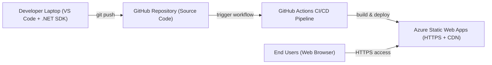

# Historical architecture sketch

Retained from the earlier documentation. It mixes local .NET tooling with static hosting and is not the current implementation diagram. See [the corrected static architecture](architecture.svg) and the current README.

