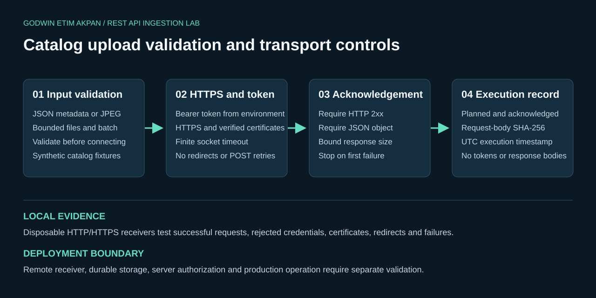

# Validated catalog uploads over HTTPS

Python clients for uploading catalog metadata and JPEG images to a configured REST API. This independent training lab now enforces transport, authentication and input contracts instead of describing those controls only in its diagram.

The clients send JSON metadata (`run.py`) and multipart JPEGs (`supplier_image_upload.py`). Both use the same validation and HTTP implementation in `upload_client.py`. They perform no work when imported.

## Implemented controls

- Remote destinations require HTTPS, certificate-chain verification and hostname verification. TLS 1.2 is the minimum. A custom trusted CA file can be supplied; there is no verification-disable option.
- Every upload requires a bearer token in `UPLOAD_API_TOKEN`. URL user information and query strings are rejected; there is no CLI token argument. Reports omit tokens, response bodies and metadata contents.
- HTTP is accepted only for a literal loopback IP with `--allow-local-http`. It is an explicit local testing exception, not a remote deployment mode. Do not use real service credentials for the local fixture.
- The complete batch is validated before connecting. Metadata must have a name, a positive integer weight in pounds, and a nonempty description. Multiline descriptions are preserved.
- Images must decode as JPEG, be at most 10 MiB and at most 20 million pixels. Metadata is limited to 64 KiB per file. A batch contains 1-100 files and at most 32 MiB of prepared requests. Symlink files/directories and unsafe filenames are rejected.
- Each blocking socket operation has a finite timeout. Redirects are rejected, so credentials are not forwarded. Only HTTP 2xx with a nonempty JSON object counts as an acknowledgement; response bodies are capped at 64 KiB.
- Uploads stop on the first failure and return a nonzero exit code. The JSON report records planned and acknowledged counts, HTTP statuses and SHA-256 hashes of request bodies.

## Architecture



1. Read a trusted local directory and validate all candidate inputs.
2. Read the token from the process environment only when sending.
3. Connect directly to the configured HTTPS endpoint and verify its certificate.
4. Send one POST per file without automatic retry or redirect following.
5. Validate the HTTP/JSON acknowledgement and emit a minimized execution report.

## Setup

Python 3.11 or newer. From this project directory on Windows PowerShell:

```powershell
py -3.12 -m venv .venv
.\.venv\Scripts\python.exe -m pip install -r requirements-dev.txt
.\.venv\Scripts\python.exe -m unittest discover -s tests -v
.\.venv\Scripts\python.exe validate.py
```

On macOS/Linux use `python3 -m venv .venv` and `.venv/bin/python` for the remaining commands. Runtime requires Pillow; `cryptography` is used only to generate disposable test certificates. `validate.py` runs the suite and refreshes the evidence JSON and log; using it alone is sufficient for routine reruns. Pin updates deliberately and rerun validation after upgrading.

## Validate without uploading

```powershell
.\.venv\Scripts\python.exe run.py --endpoint https://example.invalid/fruits/ --input-dir fixtures/descriptions --dry-run
.\.venv\Scripts\python.exe supplier_image_upload.py --endpoint https://example.invalid/upload/ --input-dir fixtures/images --dry-run
```

These commands read no token and open no connection. `example.invalid` is a deliberate documentation placeholder, not a deployed service. A successful dry run reports `validated_only` and zero acknowledgements.

## Upload to your configured service

Supply a token to the process through your normal protected environment or secret manager. Do not put it in scripts, screenshots, shell history or this repository. Replace the endpoint below with your intended service, which must implement the receiver contract:

```powershell
.\.venv\Scripts\python.exe run.py --endpoint https://your-service.example/fruits/ --input-dir path/to/descriptions --timeout 10
.\.venv\Scripts\python.exe supplier_image_upload.py --endpoint https://your-service.example/upload/ --input-dir path/to/jpeg-images --timeout 10
```

For a private certificate authority, add `--ca-file path/to/trusted-ca.pem`. Validate that CA's provenance separately. TLS and hostname checks remain enabled. The client uses direct `http.client` connections; environment proxy variables are not consulted.

The local test suite creates its own HTTP/HTTPS servers on `127.0.0.1`, uses a synthetic token, generates fresh short-lived certificates, and does not contact external APIs. The HTTP exception requires both a loopback address and `--allow-local-http`; `localhost` is deliberately not accepted for this exception because it is a hostname rather than a literal IP.

## Input and receiver contract

Metadata files use lowercase `.txt` names such as `001.txt`. Basenames contain only ASCII letters, digits, underscores and hyphens, start with a letter/digit and have at most 80 characters before the suffix:

```text
Demonstration apples
500 lbs
Synthetic description; subsequent lines are preserved.
```

`weight` accepts an integer from 1 to 1,000,000, optionally followed by `lbs`. JSON fields are `name`, `weight`, `description`, and `image_name`; the latter is the metadata basename plus `.jpeg`. Images use lowercase `.jpeg` or `.jpg` and a multipart field named `file`; the transmitted filename is normalized to the basename plus `.jpeg` to match metadata references. Matching image existence is not required for a metadata-only upload. The two entry points are separate operations, not an atomic transaction.

The receiver must validate bearer credentials and its own input rules, then return HTTP 2xx with `Content-Type: application/json` and a nonempty object such as `{"id": 1}`. The client does not print or persist arbitrary response fields. Acknowledgement alone is not proof of durable storage, server-side authorization, malware screening or database correctness.

## Execution reports and failure handling

Stdout contains one JSON report. Successful sends report `acknowledged`; validation-only runs report `validated_only`. Validation, transport and acknowledgement failures exit 1. Argument parsing errors exit 2. `timestamp_utc` is generated at execution time. Input filenames appear in reports: use non-sensitive catalog identifiers.

`request_sha256` describes the exact transmitted body, not the original file. For multipart requests it includes a freshly randomized boundary, so that hash can differ between otherwise identical runs. The token is excluded from that hash and the output.

There is no automatic POST retry. A timeout, disconnected response or rejected acknowledgement can occur after a server accepted the item. Check receiver-side state before retrying; otherwise duplicates are possible. Partial reports distinguish acknowledged items from the remainder, but there is no rollback or exactly-once guarantee. Socket timeouts are per blocking operation, not a total wall-clock batch deadline.

## Evidence and scope

The recorded run passed 29 tests with no failures, errors or skips. See `evidence/validation.json` and `evidence/test-results.txt` for the executed checks and environment. They distinguish local synthetic integration tests from an external deployment. No public service, cloud storage, production credentials, OAuth flow, RBAC system, scheduled uploader or sustained load test is included.

The catalog image/fruit fixtures are synthetic. This is not a geospatial raster ingestion system. Input folders must be controlled by the operator; this client is not a sandbox for files concurrently modified by a hostile local process. Server-side file handling, retention, rate limits, content scanning and authorization must be assessed separately for a real deployment.

The legacy uploader under the separate `Image_Processing` folder is not replaced by this package. Use the two entry points in this folder for this corrected workflow; the earlier audit still applies to that separate exercise.

## Files

| File | Purpose |
| --- | --- |
| `run.py` | Metadata entry point |
| `supplier_image_upload.py` | JPEG entry point |
| `upload_client.py` | Shared validation, TLS, bearer authentication, bounded requests and reporting |
| `tests/test_upload.py` | Local policy, input, acknowledgement and transport contracts |
| `fixtures/` | Synthetic metadata and small JPEG |
| `docs/architecture.svg` | Implemented controls and explicit evidence boundaries |
| `requirements.txt` | Runtime dependency pin |
| `requirements-dev.txt` | Test dependency pin |

References: [Python HTTP client](https://docs.python.org/3/library/http.client.html), [Python TLS contexts](https://docs.python.org/3/library/ssl.html#ssl.create_default_context), and [Pillow release notes](https://pillow.readthedocs.io/en/stable/releasenotes/). This lab is part of the [automation portfolio](../README.md).
