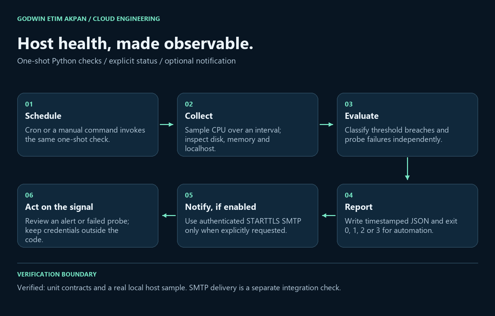

# System Health Monitoring

**A clear signal when a host needs attention.**

A one-shot Python monitor that turns resource measurements into timestamped JSON, explicit exit codes and optional authenticated email alerts. Failed measurements remain visible instead of silently becoming healthy results.



## What was implemented

- **Collect a sample** — Measure CPU over a positive interval, disk free percentage, available memory and localhost IPv4 resolution.
- **Keep failures visible** — Capture errors per probe and continue collecting the remaining measurements.
- **Evaluate consistently** — Treat CPU at or above its limit and disk or memory at or below their limits as alerts.
- **Report and notify** — Write JSON every run. Email requires an explicit flag and credentials supplied through the environment.

## Validation and evidence

Executed unit checks and a real local host sample. SMTP transmission was not exercised.

- **Contract checks: 11 passed** — Tests cover threshold boundaries, probe failures, default notification behavior, SMTP sequencing and exit codes.
- **Real host run: Alert returned** — The corrected monitor detected low free disk space during a local sample. No email was sent.
- **Email integration: Prepared** — SMTP call ordering is tested with a mock; real delivery requires a separately configured and verified mail service.

See [evidence/validation.json](evidence/validation.json) and [the executed test log](evidence/local-tests.txt). Test counts refer to local tests, not proof of production readiness.

## Run it

Python 3.10+ and the pinned psutil dependency are required. From this folder:

```sh
python -m venv .venv
# Activate .venv using the command for your operating system.
python -m pip install -r requirements.txt
python -m unittest -v
python health_check.py --interval 1 --disk-path /
```

On Windows, use `--disk-path C:\`. Exit 1 can be a correctly detected alert, not a crashed process. The script always prints JSON. Exit 2 indicates a failed probe; exit 3 indicates failed email delivery. CPU >=80%, disk free <=20% and available memory <=100 MiB are the default alert conditions.

For Linux cron, use absolute paths to your interpreter, script and log, for example:

```cron
*/5 * * * * /opt/host-monitor/.venv/bin/python /opt/host-monitor/health_check.py --disk-path / >> /var/log/host-monitor.log 2>&1
```

Cron paths are deployment examples, not files supplied in this repository. Each run writes a formatted JSON document to the example log. Rotate logs and verify permissions. SMTP is disabled by default. To enable it, inject `MONITOR_SMTP_HOST`, `MONITOR_SMTP_PORT` (default 587), `MONITOR_SMTP_USER`, `MONITOR_SMTP_PASSWORD`, `MONITOR_FROM` and `MONITOR_TO` through your service's protected environment, then add `--send-email`. Do not commit credentials or put passwords in crontab. Authenticated STARTTLS is required; do not disable certificate verification to make a failing connection pass.


## Files and output mapping

- health_check.py — collection, evaluation, JSON reporting and optional SMTP
- test_health_check.py — failure and boundary contracts
- evidence/validation.json and local-tests.txt — executed checks
- evidence/host-run-summary.json — minimized summary of the local sample
- docs/architecture.svg, architecture-mobile.svg and architecture.png — original diagrams of this implementation.

## Scope and limitations

- **One-shot lab monitor** — No alert deduplication, escalation, retention service or production availability guarantee is implemented.
- **Environment-specific checks** — A successful local Windows sample does not establish Linux cron operation. Linux scheduling and SMTP delivery need their own checks.
- **Point-in-time measurements** — A short CPU interval and fixed memory threshold are demonstration settings, not a capacity-planning model.

## Next technical priorities

- **Confirm the Linux integration** — Run from the target virtual environment under cron and verify logs and exit handling.
- **Close the notification loop** — Use a dedicated test mailbox, trigger a controlled alert and verify receipt before enabling routine notifications.

## References

- https://psutil.readthedocs.io/stable/
- https://docs.python.org/3/library/smtplib.html

## Author

Godwin Etim Akpan · Geospatial & Data Engineer
