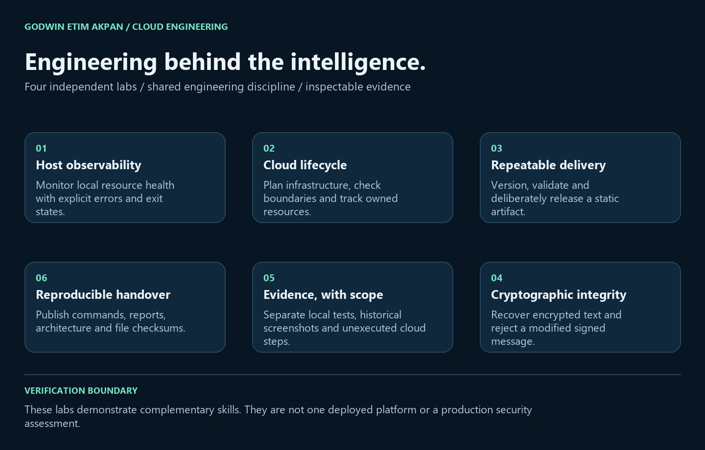

# Cloud engineering labs

Four independently runnable demonstrations of monitoring, infrastructure lifecycle, static delivery and cryptographic verification.

- [System Health Monitoring](6_Automation_Reliability/System_Health_Monitoring)
- [AWS Infrastructure Lifecycle](4_Cloud_Computing_Security/aws-ec2-cli-lab)
- [Azure Static Delivery](4_Cloud_Computing_Security/azure-hello-world)
- [Applied Cryptography](4_Cloud_Computing_Security/applied-cryptography-openpgp)

Run `python validate_cloud_projects.py` from the repository root after installing the monitoring dependency. It executes local tests only. See CLOUD-VALIDATION.json for recorded results. Architecture source is in tools/render_cloud_architecture.py (optional Pillow 11.3.0 required for PNG export). Live AWS, Azure and SMTP checks are separate; GnuPG has its own real execution report.

